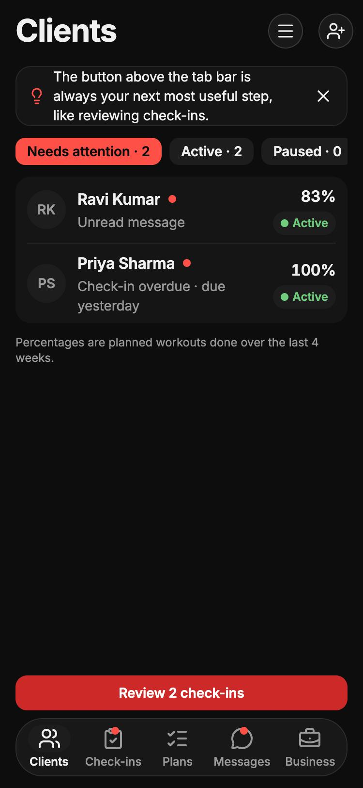
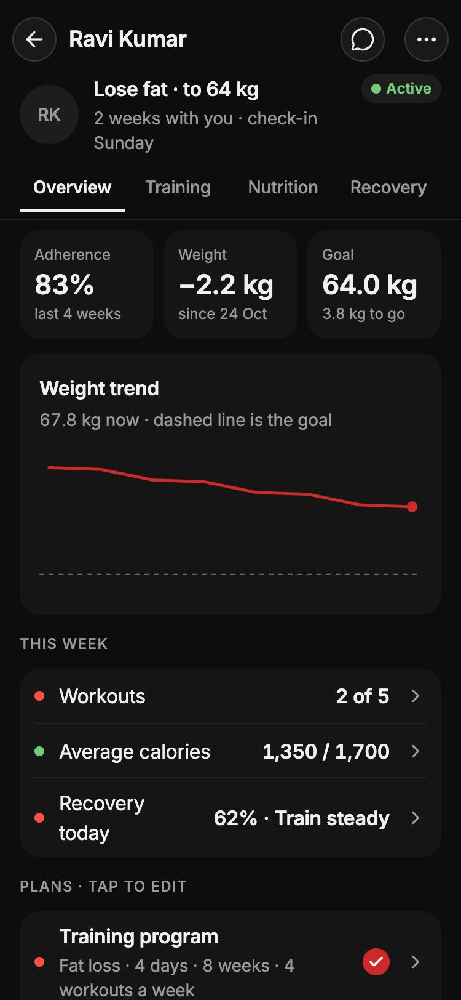
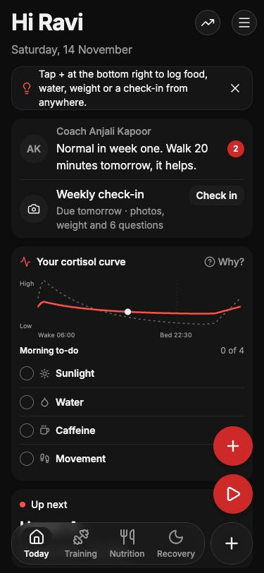
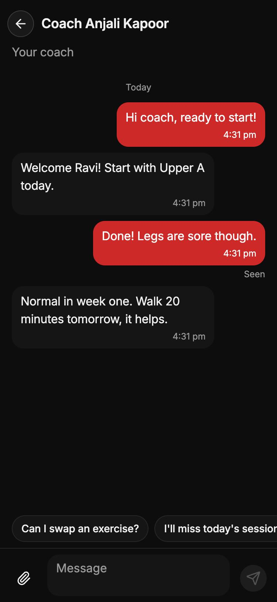
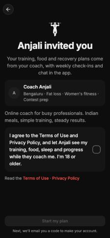
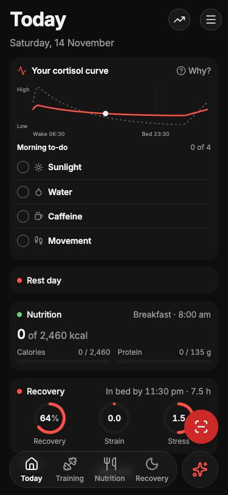

# Running the Arcwell demo (free, local)

This is the investor demo on the free local backend (D107, LAUNCH_ROADMAP §7). It uses real accounts, real row-level security and real sync between a coach and their clients. Nothing here costs money.

| | |
|---|---|
|  |  |
|  |  |
|  |  |

## One-time setup

You need Node 20+ and Docker Desktop running.

```bash
npm install
npm --prefix app install
```

Copy `app/.env.example` to `app/.env`, then fill it in:

- `EXPO_PUBLIC_SUPABASE_URL=http://127.0.0.1:54321`
- `EXPO_PUBLIC_SUPABASE_PUBLISHABLE_KEY=`: the `PUBLISHABLE_KEY` that `npm run db:start` prints.
- `EXPO_PUBLIC_DEMO_BILLING=1`: lets the paywall start a 7-day Plus trial without Google Play.

Copy `supabase/functions/.env.example` to `supabase/functions/.env` and set `DEMO_BILLING=on`.

## Every demo

1. **Start the backend** (database, sign-in, storage, realtime, functions):

   ```bash
   npm run db:start
   ```

2. **Load the demo people**: a coach, two coached clients with three weeks of history, and a self-guided Plus athlete. `--reset` starts from a clean database.

   ```bash
   npm run demo:seed -- --reset
   ```

3. **Start the server functions** (demo billing, push, webhooks), in a second terminal:

   ```bash
   npx supabase functions serve --env-file supabase/functions/.env
   ```

4. **Start the app** in a third terminal, then open the web build at http://localhost:8081, or scan the QR code with Expo Go:

   ```bash
   npm --prefix app run start
   ```

5. **Sign in** with "I have an account". The code arrives in the local inbox at http://127.0.0.1:54324.

## Demo accounts

| Email | Who | What to show |
|---|---|---|
| `anjali@arcwell.test` | Coach Anjali Kapoor | Clients list with adherence and who needs attention, a client's weight trend and this week's numbers, check-ins to review, chat, templates, invite link |
| `ravi@arcwell.test` | Coached client, fat loss | Today with the coach's message, the coach's plan in Training, workouts, food, check-ins with the coach's reply |
| `priya@arcwell.test` | Coached client, muscle gain | Same, with a check-in overdue |
| `meera@arcwell.test` | Self-guided, Arcwell Plus trial | The AI coach button, Recovery, a plan built from her answers |

## The live story

To show two phones, use two browser windows. One opens http://localhost:8081 and the other http://127.0.0.1:8081: different addresses keep separate sign-ins.

1. **The coach adds a client.** Coach: Clients → Add a client, then build the training, nutrition and recovery plans, then Create invite. Note the code.
2. **The client joins.** Second window: Get started → "Have an invite code from your coach?" → enter the code. The coach's profile shows before sign-up. Tick consent, then sign up with any `@arcwell.test` email. The plan is already there.
3. **Live chat.** Client sends a message; it appears on the coach's side within seconds. The coach replies back.
4. **Workout and food.** The client logs a workout and a meal. The coach's client page shows them on the next refresh, within about 20 seconds.
5. **Check-in loop.** The client sends a check-in; it appears in the coach's Check-ins. The coach replies, and the client sees "Coach replied to your check-in".
6. **Privacy rules.** The coach only ever sees their own clients, and only from the day each one joined. The athlete can share earlier history in Privacy.
7. **Arcwell Plus.** A new self-guided athlete finishes onboarding, signs up and starts the 7-day trial. The server makes them Plus, and AI features appear.
8. **AI coach.** As Meera, open the AI coach and ask about protein: the answer uses her real week and cites its sources. Weekly review gives suggestions from her logs. Ask about creatine or an injury: it declines. Coached athletes like Ravi never get AI, and the server refuses them even by direct call.

## What's real and what's stand-in

| Real now | Stand-in until funding (LAUNCH_ROADMAP §7) |
|---|---|
| Accounts, emailed sign-in codes, roles | Codes go to the local inbox, not real email (Resend later) |
| Every table behind row-level security (177 database tests) | Runs on this laptop, not a hosted server (Supabase Pro later) |
| Coach ⇄ athlete sync: plans, workouts, food, check-ins, chat, photos, export, delete | Push notifications need a development build (EAS, free tier) |
| Billing logic, RevenueCat and Razorpay webhooks (tested with signed test events) | Plus is granted by `demo-billing`, not a Google Play purchase |
| AI coach on the server: chat, tailor today and the weekly review, behind entitlement, daily caps and checks (D108) | Without a Groq key the rules engine answers. A free key (console.groq.com, `GROQ_API_KEY` and `GROQ_MODEL` in `supabase/functions/.env`) switches on the model |
