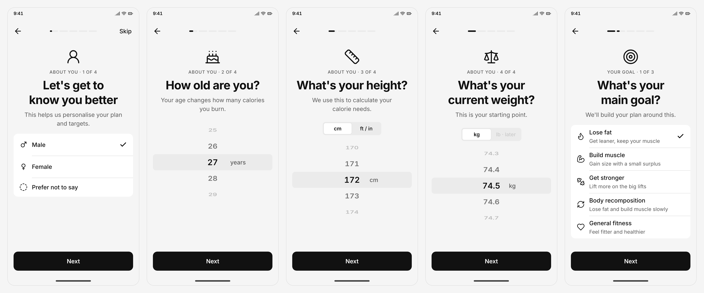
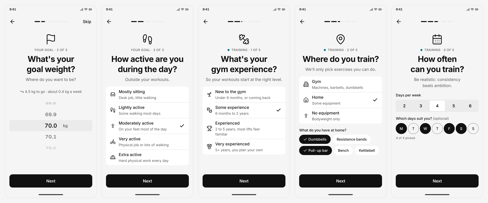

# Arcwell — Design

Single source of truth for Arcwell's UI/UX: principles, brand, app structure, flows, design tokens, components and screen status. Code in `app/src/theme/` must match the tokens here; change this file first, then the code.

Mockups and wireframes live in `docs/design/`.

**Pre-design research (complete these before designing screens):**

| Document | Contents |
|---|---|
| [Brand and product assessment](design/brand-assessment.md) | What the brand stands for, what the app must achieve, personas, jobs to be done |
| [Sitemap](design/sitemap.md) | Every v1 screen, by role and tier |
| [Competitor research](design/competitor-research.md) | Landscape, comparison, gaps Arcwell can own, UX patterns to adopt |
| [Design references](design/references.md) | Dribbble/Behance/shipped-app references by category, patterns to avoid |
| [Assets and licences](design/assets.md) | Fonts, icons, illustrations, photos, exercise media, data — with licence status |
| [Spec sheet](design/spec-sheet.html) | Visual design system: every token, component and motion rule, rendered (open in a browser) |
| [Design generation prompt](design/design-prompt.md) | AI design-tool prompts for the athlete app and coach workspace |

## 0. Working decisions (adopted as v1 defaults, 2026-11-11 — DECISIONS.md D45)

| Decision | Current default | Why |
|---|---|---|
| Who designs | Founder + Claude; design system built directly in code, rough layouts as mockups | No design budget yet |
| Where designs live | Interactive HTML mockups in `docs/design/` (Figma later if a designer joins) | No tool to learn; shareable |
| Reference apps | Hevy (workout logging), MyFitnessPal (food logging), Trainerize/TrueCoach (coach side) | Proven patterns for each job |
| Theme | Dark-first, with a light theme | Gym use, low light, OLED Android phones |
| Language | English only at launch; layouts allow ~40% longer text for a later Hindi version | Avoid redesign when adding Hindi |
| Ergonomics | One-handed use mid-workout | Logging happens between sets |

## 1. Design principles

1. **Logging in seconds.** The most common actions (log a set, log a meal) take one or two taps. Pre-fill from the last session; never make people type what we can suggest.
2. **One thumb, sweaty hands.** Primary actions sit in the bottom half of the screen. Tap targets are at least 48dp. No precision gestures mid-workout.
3. **Today first.** Every role opens on what needs doing *today*: the athlete's workout and targets, the coach's overdue check-ins and unread messages.
4. **Coach's tool, athlete's companion.** The coach side is dense and efficient (a work tool). The athlete side is calm and encouraging (a daily habit).
5. **Honest numbers.** Show real data plainly. No fake precision, no shaming red for missed days; progress is shown as trends over time.
6. **Three pillars, three colours.** Training, Nutrition and Recovery each have one consistent colour across the app, so people always know where they are.
7. **Never show what you can't use.** Coached athletes never see AI. Free users see locked features only at natural upgrade moments, not everywhere.

## 2. Brand

- **Name:** Arcwell. "Arc" as in a transformation arc; "well" as in health and recovery.
- **Personality:** calm, competent, trustworthy — a serious coach's tool. Not loud, not "bro", not gamified.
- **Tagline (draft):** "Training, nutrition and recovery, coached as one."
- **Voice:** plain, short, encouraging. Say "Log set", not "Crush it!". Address the user as "you". Use Indian English and Indian units (kg, cm, katori).

## 3. App structure (information architecture)

Confirmed rules come from [DECISIONS.md](DECISIONS.md) (IDs in brackets). Section names as drawn are the v1 names (D45).

### Athlete bottom bar, by tier

| Tier | Bottom bar | Source |
|---|---|---|
| Free | Today · Training · Nutrition (no Recovery, no extra tabs) | D2b |
| AI-coached (Pro) | Today · Training · Nutrition · Recovery · AI Coaching | D2 |
| Human-coached (Pro) | Today · Training · Nutrition · Recovery · Progress — Progress is the combined Check-ins · Progress · Chat area | D2a, D11 |

- **Side menu (☰)** for all athletes, supplementing the bottom bar (D9, D14): Account · Notifications · Training (Exercises, Workouts, Programs, History, Muscle Analytics) · Gyms · Physique (Bodyweight, Measurements, Photos, Charts). No Set Videos.
- **Free access per item** (D13, D25): Exercises ✓ · Workouts (templates only) · History ✓ · Gyms ✓ · Physique ✓ · Programs 🔒 Pro · Muscle Analytics 🔒 Pro.
- **Workouts** are standalone sessions; **Programs** are multi-week plans (D13). **Gyms** is a read-only map / directory (D15).
- **Coached Progress switch** is a timeline of past check-ins and coach feedback (D16).
- **Physique tools** are free and live in the side menu for everyone (D5, D9).
- **Pro access** covers AI subscribers and human-coached athletes; coached athletes need no AI subscription and never see AI coaching (D10).
- **Recovery** = sleep / sleep score (0–100 dial), soreness, fatigue; hidden for free users (D4, D5a, D18).
- **Today** layouts N-01 to N-03 are final (D2d, D23).

### Coach (final for v1, D23)

| Tab | Contents |
|---|---|
| **Clients** | Client list sorted by "needs attention"; filters by status; client profiles |
| **Check-ins** | Inbox of submitted check-ins to review and reply to |
| **Plans** | Training and meal plan templates; plan builders; assigning |
| **Messages** | All client chats |
| **Business** | Leads, invite link, coach profile, transformations, plan and billing, settings |

## 4. Core flows to design first

| # | Flow | Status |
|---|---|---|
| F1 | Sign-up → choose role → onboarding questions | Wireframed — [f1-f3-onboarding.html](design/wireframes/f1-f3-onboarding.html) |
| F2 | Coach first run → profile → first template → share invite link | Wireframed — [f2-coach-onboarding.html](design/wireframes/f2-coach-onboarding.html) |
| F3 | Client taps invite link → installs → signs up → linked to coach | Wireframed — [f1-f3-onboarding.html](design/wireframes/f1-f3-onboarding.html) |
| F4 | Log a workout (start, log sets, rest timer, finish, summary) | Wireframed — [f4-workout-logging.html](design/wireframes/f4-workout-logging.html) |
| F5 | Log food (search, pick portion, add to meal; paid: photo) | Wireframed — [f5-food-logging.html](design/wireframes/f5-food-logging.html) |
| F6 | Weekly check-in (athlete submits → coach reviews and replies) | Wireframed — [f6-f7-checkins-chat.html](design/wireframes/f6-f7-checkins-chat.html) |
| F7 | Chat (text, image, PDF) | Wireframed — [f6-f7-checkins-chat.html](design/wireframes/f6-f7-checkins-chat.html) |
| F8 | Upgrade to paid AI tier (paywall) | Wireframed — [f8-f9-paywall-photos.html](design/wireframes/f8-f9-paywall-photos.html) |
| F9 | Transformation photo consent (request → approve with blur → withdraw) | Wireframed — [f8-f9-paywall-photos.html](design/wireframes/f8-f9-paywall-photos.html) |
| F10 | Bottom bars, side menu, Today by tier, notifications, account, privacy, export, delete, password reset | Wireframed — [f10-menu-today-account.html](design/wireframes/f10-menu-today-account.html) |
| F11 | Recovery, Physique tools, AI Coaching | Wireframed — [f11-recovery-physique-ai.html](design/wireframes/f11-recovery-physique-ai.html) |
| F12 | Coached Progress area, waiting for a plan, joining and leaving a coach | Wireframed — [f12-coached-area-switching.html](design/wireframes/f12-coached-area-switching.html) |
| F13 | Coach clients, client profile, plan and meal plan builders, assigning, leads, business | Wireframed — [f13-coach-tools.html](design/wireframes/f13-coach-tools.html) |
| F14 | Coach client-profile sections (nutrition, recovery, progress, check-ins, notes), coach sign-up, profile, settings | Wireframed — [f14-coach-profile-settings.html](design/wireframes/f14-coach-profile-settings.html) |
| F15 | Training landing by tier, exercise library, profile, units, help, upgrade "what changed", reusable states | Wireframed — [f15-training-account-states.html](design/wireframes/f15-training-account-states.html) |
| F16 | Missing states from the wireframe audit: AI limit and failure, edit or delete food, image and PDF viewers, notification permission, export states, athlete and coach empty states, meal plan templates, coach exercise library, force update, maintenance | Wireframed — [f16-states-empty-system.html](design/wireframes/f16-states-empty-system.html) |
| F17 | Training menu (Workouts, Programs, Muscle Analytics, timed sets), Gyms, coached Progress timeline and past check-ins, coach recovery target, history access, coaching status, invite consent, AI off and out-of-scope, trial end | Wireframed — [f17-training-menu-gyms-progress.html](design/wireframes/f17-training-menu-gyms-progress.html) |
| F18 | Coach recovery target, completing a client, client limit, billing lapse, deleting a coach account | Wireframed — [f18-coach-lifecycle.html](design/wireframes/f18-coach-lifecycle.html) |

"Wireframed" means **drawn**. All v1 flows are drawn (199 screens) and no open decisions remain on any screen: every decision is in DECISIONS.md (D1–D45; D25–D45 are defaults Claude applied, for founder review). No screen has been reviewed screen by screen or tested with users.

### Onboarding mockups (hi-fi, D52 and D53)

Draft, not approved or user-tested. Rendered at 3× from [onboarding-flow.html](design/hifi-mockups/onboarding-flow.html); the full set of athlete and coach screens and the clickable prototype are in `design/hifi-mockups/`.

**AO-01 to AO-05:** gender, age, height, current weight, main goal

**AO-06 to AO-10:** goal weight, activity level, gym experience, where you train, training days

## 5. Design tokens (v0 — draft)

### Colour

Monochrome light theme (D50, replaces the blue of D49 on 2026-11-11; earlier palettes in DECISIONS.md D47 and D49):

| Token | Value | Use |
|---|---|---|
| `bg` | `#F5F5F5` | App background (light grey) |
| `surface` | `#FFFFFF` | Cards, sheets |
| `surfaceRaised` | `#EBEBEB` | Inputs, pressed states |
| `border` | `#E0E0E0` | Dividers only |
| `borderStrong` | `#7A7A7A` | Input, tick-box and secondary-button outlines (3:1+ on every surface) |
| `text` | `#111111` | Primary text |
| `textMuted` | `#5C5C5C` | Secondary text |
| `textDisabled` | `#A3A3A3` | Disabled controls only (WCAG-exempt) |
| `brand` | `#111111` | Primary actions (black buttons) |
| `brandHover` | `#333333` | Hover / pressed step |
| `onBrand` | `#FFFFFF` | Text on black buttons |
| `accent` / `focus` | `#111111` | Selection, focus, active tab |
| `training` | `#0E7490` | Training pillar marker |
| `nutrition` | `#C2570C` | Nutrition pillar marker |
| `recovery` | `#6D5BD0` | Recovery pillar marker |
| `success` | `#127235` | Completed, positive |
| `warning` | `#A34A06` | Needs attention |
| `danger` | `#C81E1E` | Destructive actions, errors only |
| `scrim` | `rgb(17 17 17 / 0.4)` | Dims the screen behind modal sheets and dialogs |

Black and white first: black is the only action colour; colour is kept for small pillar dots (never text) and status; progress bars, rings, ticks and charts are black. Solid colours only: no gradients, no glows, no shadows. Every text pair passes WCAG AA (checked 2026-11-11: text 17.3:1, muted 6.1:1, white on black 18.9:1). No streaks, XP or badges.

### Typography

- **Font:** Inter (open licence), with tabular numerals for weights, reps, calories and timers.
- **Scale:** `display` 32/40 bold · `title` 22/28 semibold · `heading` 18/24 semibold · `body` 16/24 regular · `label` 14/20 medium · `caption` 12/16 regular.
- Respect the system font-size setting; layouts must survive 130% text size.

### Spacing, shape, motion

- **Spacing:** 4-point scale — 4, 8, 12, 16, 24, 32, 48.
- **Radius:** 8 (inputs, chips) · 12 (cards) · 20 (sheets) · full (pills, avatars).
- **Tap targets:** minimum 48 × 48dp.
- **Motion** (rendered in the spec sheet): changing numbers roll instead of jumping. Tokens: micro 120 ms (press, tick), standard 200 ms (number rolls, cards, tabs), sheet 280 ms, big moment 600 ms. Easing `cubic-bezier(.2,0,0,1)`, built with React Native Reanimated. The only big animation is the workout summary (F4-12): ring fills, volume rolls up, new bests slide in, strong haptic, no confetti. Skeleton loaders, never spinners. No animated backgrounds. With Android "Remove animations" on, every transition is instant. Haptic tick when a set is logged.

## 6. Components (to build in `app/src/components/`)

| Component | Notes | Status |
|---|---|---|
| Button (primary, secondary, ghost, destructive) | 48dp min height | In spec sheet · built in `app/src/components/` (Phase 2; draft, not approved or user-tested) |
| Text input, number stepper | Number stepper for kg/reps with big ± targets | In spec sheet · built in `app/src/components/` (Phase 2; draft, not approved or user-tested) |
| Card, list row, section header | | In spec sheet · built in `app/src/components/` (Phase 2; draft, not approved or user-tested) |
| Tab bar (athlete, coach variants) | | In spec sheet · not built |
| Set row | Previous value, weight, reps, done tick; the heart of logging | In spec sheet · not built |
| Rest timer | Bottom sheet, haptic at end | In spec sheet · not built |
| Macro ring / calorie bar | Pillar colours; spec sheet uses bars, not rings | In spec sheet · not built |
| Food result row, portion picker | Indian portions | In spec sheet · not built |
| Chat bubble, attachment tile | Images, PDFs | In spec sheet · not built |
| Check-in form fields, photo slot | | Not in spec sheet yet |
| Empty state, error state, skeleton loader | Every list has all three | In spec sheet · built in `app/src/components/` (Phase 2; draft, not approved or user-tested) |
| Paywall / locked-feature card | Shown only at upgrade moments | In spec sheet · not built |
| Avatar, status chip (active, paused, leaving, completed) | | In spec sheet · built in `app/src/components/` (Phase 2; draft, not approved or user-tested) |

## 7. Screen inventory

Tracked here as screens are designed (Wireframe → Mockup → Built). **✅ in the Wireframe column means drawn only** — not reviewed by the founder, not tested with users.

**Onboarding IDs changed on 2026-11-12 (D52).** Athlete onboarding is now AO-xx and coach onboarding CO-xx, the same IDs in wireframes and mockups. Old IDs in earlier decisions map like this:

| Old | New | Old | New |
|---|---|---|---|
| F1-06 Goal | AO-05 | F2-01 What you get | CO-02 |
| F1-07 Experience | AO-08 | F2-02 Coach agreement | CO-03 |
| F1-08 Body stats | AO-01 to AO-04 | F2-03 Profile basics | CO-06, CO-07 |
| F1-09 Injuries | AO-12 | F2-04 About you | CO-08 |
| F1-10 Schedule | AO-10, AO-11 | F2-05 Services | CO-09 |
| F1-11 Equipment | AO-09 | F2-06 First template | CO-10 |
| F1-12 Diet type | AO-16 | F2-07 Invite clients | CO-11 |
| F1-13a Summary — free | AO-18 to AO-21 | F2-08 to F2-10 | CO-13 to CO-15 |
| F1-13b Summary — coached | AO-21b | K-19 Coach sign-up | CO-01 (same screen) |

New with D52: AO-02, AO-06, AO-07, AO-13 to AO-15, AO-17, AO-18, AO-20, CO-04, CO-05, CO-07, CO-12. "✅ draft" in the Mockup column means a hi-fi mockup exists in `design/hifi-mockups/`, not approved or user-tested.

| Screen | Role | Wireframe | Mockup | Built |
|---|---|---|---|---|
| F1-01 Splash | All | ✅ | ✅ draft | — |
| F1-02 Welcome | All | ✅ | ✅ draft | — |
| F1-02a Choose your role (sheet) | All | ✅ | ✅ draft | — |
| F1-03 Sign up | All | ✅ | ✅ draft | — |
| F1-04 Sign in | All | ✅ | ✅ draft | — |
| F1-05 Consent | All | ✅ | ✅ draft | — |
| AO-01 Gender | Athlete | ✅ | ✅ draft | — |
| AO-02 Age | Athlete | ✅ | ✅ draft | — |
| AO-03 Height | Athlete | ✅ | ✅ draft | — |
| AO-04 Current weight | Athlete | ✅ | ✅ draft | — |
| AO-05 Main goal | Athlete | ✅ | ✅ draft | — |
| AO-06 Goal weight | Athlete | ✅ | ✅ draft | — |
| AO-07 Activity level | Athlete | ✅ | ✅ draft | — |
| AO-08 Gym experience | Athlete | ✅ | ✅ draft | — |
| AO-09 Where you train | Athlete | ✅ | ✅ draft | — |
| AO-10 Training days | Athlete | ✅ | ✅ draft | — |
| AO-11 Session length and time | Athlete | ✅ | ✅ draft | — |
| AO-12 Injuries and limitations | Athlete | ✅ | ✅ draft | — |
| AO-13 Sleep | Athlete | ✅ | ✅ draft | — |
| AO-14 Sleep quality | Athlete | ✅ | ✅ draft | — |
| AO-15 Stress and energy | Athlete | ✅ | ✅ draft | — |
| AO-16 Diet type | Athlete | ✅ | ✅ draft | — |
| AO-17 Meals per day | Athlete | ✅ | ✅ draft | — |
| AO-18 Building your plan | Athlete (free) | ✅ | ✅ draft | — |
| AO-19 Calorie target | Athlete (free) | ✅ | ✅ draft | — |
| AO-20 Plan preview | Athlete (free) | ✅ | ✅ draft | — |
| AO-21 All set — free | Athlete (free) | ✅ | ✅ draft | — |
| AO-21b All set — coached | Athlete (coached) | ✅ | ✅ draft | — |
| CO-02 Coach — what you get | Coach | ✅ | ✅ draft | — |
| CO-03 Coach agreement | Coach | ✅ | ✅ draft | — |
| CO-04 How you coach | Coach | ✅ | ✅ draft | — |
| CO-05 Clients today | Coach | ✅ | ✅ draft | — |
| CO-06 Coach profile basics | Coach | ✅ | ✅ draft | — |
| CO-07 Specialisations | Coach | ✅ | ✅ draft | — |
| CO-08 About you | Coach | ✅ | ✅ draft | — |
| CO-09 Services | Coach | ✅ | ✅ draft | — |
| CO-10 First template | Coach | ✅ | ✅ draft | — |
| CO-11 Invite clients | Coach | ✅ | ✅ draft | — |
| CO-12 Ready to coach | Coach | ✅ | ✅ draft | — |
| CO-13 Clients — empty with setup checklist | Coach | ✅ | ✅ draft | — |
| CO-14 Clients — first clients join | Coach | ✅ | ✅ draft | — |
| CO-15 New client — assign plan | Coach | ✅ | ✅ draft | — |
| F3-01 Invite shared (WhatsApp) | Coach → client | ✅ | ✅ draft | — |
| F3-02 Invite landing | Athlete | ✅ | ✅ draft | — |
| F3-03 Already coached (switch coach) | Athlete | ✅ | ✅ draft | — |
| F4-01 Today — workout entry point | Athlete | ✅ | — | — |
| F4-02 Workout preview | Athlete | ✅ | — | — |
| F4-03 Active workout — set logging | Athlete | ✅ | — | — |
| F4-04 Rest timer | Athlete | ✅ | — | — |
| F4-05 Edit weight / reps | Athlete | ✅ | — | — |
| F4-06 Exercise options | Athlete | ✅ | — | — |
| F4-07 Swap exercise | Athlete | ✅ | — | — |
| F4-08 Exercise detail | Athlete | ✅ | — | — |
| F4-09 Offline during workout | Athlete | ✅ | — | — |
| F4-10 Minimised workout | Athlete | ✅ | — | — |
| F4-11 Finish confirmation | Athlete | ✅ | — | — |
| F4-12 Workout summary | Athlete | ✅ | — | — |
| F4-13 Workout history | Athlete | ✅ | — | — |
| F5-01 Day log — paid / coached | Athlete (paid, coached) | ✅ | — | — |
| F5-02 Day log — free | Athlete (free) | ✅ | — | — |
| F5-03 Empty day | Athlete | ✅ | — | — |
| F5-04 Add food — recent | Athlete | ✅ | — | — |
| F5-05 Search results | Athlete | ✅ | — | — |
| F5-06 Portion picker | Athlete | ✅ | — | — |
| F5-07 Quick add | Athlete | ✅ | — | — |
| F5-08 Create custom food | Athlete | ✅ | — | — |
| F5-09 Photo — camera | Athlete (paid) | ✅ | — | — |
| F5-10 Photo — analysing | Athlete (paid) | ✅ | — | — |
| F5-11 Photo — confirm results | Athlete (paid) | ✅ | — | — |
| F5-12 Coach meal plan | Athlete (coached) | ✅ | — | — |
| F5-13 AI meal plan | Athlete (paid) | ✅ | — | — |
| F5-14 Upgrade moment | Athlete (free) | ✅ | — | — |
| F6-01 Progress area — check-in due | Athlete (coached) | ✅ | — | — |
| F6-02 Check-in step 1 — measurements | Athlete (coached) | ✅ | — | — |
| F6-03 Check-in step 2 — photos | Athlete (coached) | ✅ | — | — |
| F6-04 Check-in step 3 — how the week went | Athlete (coached) | ✅ | — | — |
| F6-05 Check-in review and submit | Athlete (coached) | ✅ | — | — |
| F6-06 Coach feedback received | Athlete (coached) | ✅ | — | — |
| F6-07 Check-in inbox | Coach | ✅ | — | — |
| F6-08 Check-in review | Coach | ✅ | — | — |
| F6-09 Write feedback | Coach | ✅ | — | — |
| F6-10 Check-in schedule | Coach | ✅ | — | — |
| F7-01 Chat with coach | Athlete (coached) | ✅ | — | — |
| F7-02 Attach sheet | Athlete, Coach | ✅ | — | — |
| F7-03 Chat — poor connection | Athlete, Coach | ✅ | — | — |
| F7-04 Messages list | Coach | ✅ | — | — |
| F7-05 Chat with client context | Coach | ✅ | — | — |
| F8-01 Paywall | Athlete (free) | ✅ | — | — |
| F8-02 Trial timeline | Athlete (free) | ✅ | — | — |
| F8-03 AI consent | Athlete (upgrading) | ✅ | — | — |
| F8-04 Google Play purchase (system) | Athlete (upgrading) | ✅ | — | — |
| F8-05 Welcome — AI builds the plan | Athlete (paid) | ✅ | — | — |
| F8-06 Subscription details | Athlete (paid) | ✅ | — | — |
| F8-07 Payment problem (grace period) | Athlete (paid) | ✅ | — | — |
| F8-08 Subscription ended | Athlete | ✅ | — | — |
| F9-01 Transformations list | Coach | ✅ | — | — |
| F9-02 Request photos | Coach | ✅ | — | — |
| F9-03 Review request | Athlete (coached) | ✅ | — | — |
| F9-04 Adjust blur and crop | Athlete (coached) | ✅ | — | — |
| F9-05 Export approved photo | Coach | ✅ | — | — |
| F9-06 Manage and withdraw approvals | Athlete | ✅ | — | — |
| N-01 Today — free | Athlete (free) | ✅ | — | — |
| N-02 Today — AI-coached | Athlete (AI) | ✅ | — | — |
| N-03 Today — human-coached | Athlete (coached) | ✅ | — | — |
| N-04 Side menu — free | Athlete (free) | ✅ | — | — |
| N-05 Side menu — Pro | Athlete (Pro) | ✅ | — | — |
| N-06 Notifications | Athlete | ✅ | — | — |
| AC-01 Account | Athlete | ✅ | — | — |
| AC-02 Privacy and permissions | Athlete | ✅ | — | — |
| AC-03 Export my data | Athlete | ✅ | — | — |
| AC-04 Delete account | Athlete | ✅ | — | — |
| AC-05 Forgot password | All | ✅ | — | — |
| AC-06 Reset link sent / email check | All | ✅ | — | — |
| R-01 Recovery — log today | Athlete (Pro) | ✅ | — | — |
| R-02 Recovery — trends | Athlete (Pro) | ✅ | — | — |
| R-03 Recovery — first use | Athlete (Pro) | ✅ | — | — |
| PH-01 Bodyweight | Athlete | ✅ | — | — |
| PH-02 Measurements | Athlete | ✅ | — | — |
| PH-03 Photos | Athlete | ✅ | — | — |
| PH-04 Charts | Athlete | ✅ | — | — |
| AI-01 AI Coaching | Athlete (AI) | ✅ | — | — |
| AI-02 AI Coaching — permission declined | Athlete (AI) | ✅ | — | — |
| CP-01 Progress area — check-in due | Athlete (coached) | ✅ | — | — |
| CP-02 Check-in sent, awaiting feedback | Athlete (coached) | ✅ | — | — |
| CP-03 Check-in without photo permission | Athlete (coached) | ✅ | — | — |
| CP-04 Progress switch — check-in timeline | Athlete (coached) | ✅ | — | — |
| CP-05 Chat switch | Athlete (coached) | ✅ | — | — |
| W-01 Today — waiting for plan | Athlete (coached) | ✅ | — | — |
| W-02 Training — waiting for plan | Athlete (coached) | ✅ | — | — |
| J-01 Join coach — AI subscriber | Athlete (AI) | ✅ | — | — |
| J-02 End AI subscription | Athlete (AI) | ✅ | — | — |
| J-03 Joined — what changed | Athlete (coached) | ✅ | — | — |
| L-01 My coach | Athlete (coached) | ✅ | — | — |
| L-02 Leave coach — confirm | Athlete (coached) | ✅ | — | — |
| L-03 After leaving — what changed | Athlete (free) | ✅ | — | — |
| K-01 Client list | Coach | ✅ | — | — |
| K-02 Client profile — overview | Coach | ✅ | — | — |
| K-03 Client profile — training | Coach | ✅ | — | — |
| K-04 Change client status | Coach | ✅ | — | — |
| K-05 Plans — templates | Coach | ✅ | — | — |
| K-06 Plan builder — week | Coach | ✅ | — | — |
| K-07 Plan builder — exercise | Coach | ✅ | — | — |
| K-08 Assign and customise | Coach | ✅ | — | — |
| K-09 Meal plan builder | Coach | ✅ | — | — |
| K-10 Leads | Coach | ✅ | — | — |
| K-11 Lead — add or edit | Coach | ✅ | — | — |
| K-12 Business | Coach | ✅ | — | — |
| K-13 Plan and billing | Coach | ✅ | — | — |
| K-14 Client profile — nutrition | Coach | ✅ | — | — |
| K-15 Client profile — recovery | Coach | ✅ | — | — |
| K-16 Client profile — progress | Coach | ✅ | — | — |
| K-17 Client profile — check-ins | Coach | ✅ | — | — |
| K-18 Client profile — private notes | Coach | ✅ | — | — |
| K-19 Coach sign-up (CO-01 in the coach onboarding mockups) | Coach | ✅ | ✅ draft | — |
| K-20 Edit coach profile | Coach | ✅ | — | — |
| K-21 Coach settings | Coach | ✅ | — | — |
| T-01 Training — free | Athlete (free) | ✅ | — | — |
| T-02 Training — AI-coached | Athlete (AI) | ✅ | — | — |
| T-03 Training — human-coached | Athlete (coached) | ✅ | — | — |
| T-04 Exercise library | Athlete | ✅ | — | — |
| AC-07 Edit profile | Athlete | ✅ | — | — |
| AC-08 Units | Athlete | ✅ | — | — |
| AC-09 Help and support | Athlete | ✅ | — | — |
| U-01 Upgrade — what changed | Athlete (AI) | ✅ | — | — |
| S-01 Loading (pattern) | All | ✅ | — | — |
| S-02 Error and retry (pattern) | All | ✅ | — | — |
| S-03 Form validation (pattern) | All | ✅ | — | — |
| S-04 Permission denied (pattern) | All | ✅ | — | — |
| X-01 AI daily limit reached | Athlete (AI) | ✅ | — | — |
| X-02 AI plan couldn't be built | Athlete (AI) | ✅ | — | — |
| X-03 Edit a logged food | Athlete | ✅ | — | — |
| X-04 Removed — undo | Athlete | ✅ | — | — |
| X-05 Image viewer | Athlete, Coach | ✅ | — | — |
| X-06 PDF viewer | Athlete, Coach | ✅ | — | — |
| X-07 Notification permission — before asking | All | ✅ | — | — |
| X-08 Android notification dialog (system) | All | ✅ | — | — |
| X-09 Export — preparing | All | ✅ | — | — |
| X-10 Export — failed | All | ✅ | — | — |
| E-01 Workout history — empty | Athlete | ✅ | — | — |
| E-02 Notifications — empty | Athlete | ✅ | — | — |
| E-03 Exercise library — no results | Athlete | ✅ | — | — |
| E-04 Physique charts — no data | Athlete | ✅ | — | — |
| E-05 Check-in inbox — empty | Coach | ✅ | — | — |
| E-06 Messages — empty | Coach | ✅ | — | — |
| E-07 Leads — empty | Coach | ✅ | — | — |
| E-08 Transformations — empty | Coach | ✅ | — | — |
| K-22 Plans — meal plan templates | Coach | ✅ | — | — |
| K-23 Coach exercise library | Coach | ✅ | — | — |
| S-05 Force update | All | ✅ | — | — |
| S-06 Maintenance / service down | All | ✅ | — | — |
| TR-01 Workouts — free | Athlete (free) | ✅ | — | — |
| TR-02 Workouts — Pro | Athlete (Pro) | ✅ | — | — |
| TR-03 Create workout | Athlete (Pro) | ✅ | — | — |
| TR-04 Programs — Pro | Athlete (Pro) | ✅ | — | — |
| TR-05 Programs — locked | Athlete (free) | ✅ | — | — |
| TR-06 Muscle Analytics — Pro | Athlete (Pro) | ✅ | — | — |
| TR-07 Muscle Analytics — locked | Athlete (free) | ✅ | — | — |
| TR-08 Timed and bodyweight sets | Athlete | ✅ | — | — |
| G-01 Gyms — map and list | Athlete | ✅ | — | — |
| G-02 Gym detail | Athlete | ✅ | — | — |
| CP-06 Past check-in — read-only | Athlete (coached) | ✅ | — | — |
| R-04 Recovery — coached, with coach target | Athlete (coached) | ✅ | — | — |
| AC-10 Coach access to earlier history | Athlete (coached) | ✅ | — | — |
| CS-01 Coaching paused | Athlete (coached) | ✅ | — | — |
| CS-02 Coaching ending | Athlete (coached) | ✅ | — | — |
| F1-05b Consent — invite sign-up | Athlete (coached) | ✅ | ✅ draft | — |
| AI-03 Turn off AI — confirm | Athlete (AI) | ✅ | — | — |
| AI-04 Out of scope | Athlete (AI) | ✅ | — | — |
| TL-01 Trial ending reminder | Athlete (AI trial) | ✅ | — | — |
| TL-02 Trial ended — not paid | Athlete (free) | ✅ | — | — |
| K-24 Set sleep target and recovery note | Coach | ✅ | — | — |
| K-25 Client limit reached | Coach | ✅ | — | — |
| K-26 Invite page — coach is full | Athlete | ✅ | — | — |
| K-27 Coach billing lapsed | Coach | ✅ | — | — |
| K-28 Delete coach account | Coach | ✅ | — | — |
| K-29 Coach account closed | Athlete (coached) | ✅ | — | — |
| K-30 Complete a client — confirm | Coach | ✅ | — | — |

## 8. Accessibility and quality checklist

- [ ] WCAG AA contrast for all text
- [ ] 48dp tap targets
- [ ] Works at 130% system font size
- [ ] Screen-reader labels on all icons and controls
- [ ] Never rely on colour alone (add icon or text)
- [ ] Every list has empty, loading and error states
- [ ] Reduce-motion respected

## 9. Decision log

| Date | Decision |
|---|---|
| 2026-11-10 | DESIGN.md created; working assumptions in section 0 (adopted as v1 defaults on 2026-11-11, D45) |
| 2026-11-11 | Founder decisions D1–D12 recorded in [DECISIONS.md](DECISIONS.md); section 3 rewritten; F10–F13 drawn; existing screens updated |
| 2026-11-11 | F14–F16 drawn. Founder Executive Defaults (D13–D24) and Claude-applied defaults (D25–D45) recorded; every open box resolved; F17–F18 drawn; tokens moved from green to electric blue / cyan (D24) |
| 2026-11-11 | design-prompt.md rewritten per the "Designing UI without the slop" guide: shared design language, negative list, one prompt per screen with references, variations and a critique pass. Gradient token removed. Icons: Lucide. Heading font: founder kept Inter for everything (D46) |
| 2026-11-11 | Tokens written to [design/theme-tokens.css](design/theme-tokens.css). Founder kept the decided values over the brief's example values and approved the `scrim` token (D47) |
| 2026-11-11 | Founder chose to build the frontend directly from the wireframes, skipping hi-fi mockups (D48). Master directive in [frontend/EXECUTION-PROMPT.md](frontend/EXECUTION-PROMPT.md) |
| 2026-11-11 | Founder switched the app to a light theme (D49); §5 colours replaced, contrast re-checked |
| 2026-11-11 | Founder switched to a black-and-white palette from a reference screenshot (D50); blue removed, colour kept for pillar markers and status |
| 2026-11-11 | Founder chose the pull-up silhouette as the logo (D51); app icon, adaptive icon, splash, onboarding header and hi-fi mockups updated |
| 2026-11-12 | Onboarding v2 drawn from a founder reference flow (D52): athlete flow in five sections with training and recovery questions, plus coach onboarding in the same style |
| 2026-11-12 | Onboarding restyled in Apple setup-flow style with an interactive prototype (D53); welcome redrawn from the Bulky AI welcome reference with a training · meals · recovery hero and a Get Started role sheet (F1-02a) |
