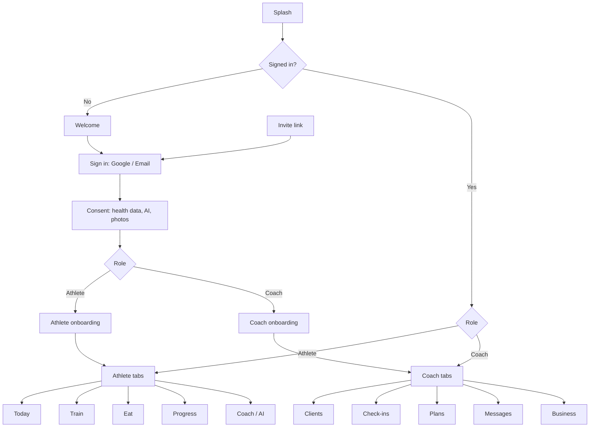

# Arcwell — Sitemap (v1)

Every screen in the v1 Android app, by role. Tier markers: **[F]** free athlete, **[P]** paid (AI) athlete, **[C]** coached athlete, **[All]** every athlete. 🔒 = shown locked to free users as an upgrade moment. AI screens are never shown to coached athletes.

## Overview

## 1. Entry and account (shared)

- Splash
- Welcome (value proposition, "I'm a coach" / "I'm training")
- Sign in / sign up — Google, email (+ email verification, forgot password)
- Invite landing (opened from a coach's link: "Join Coach Joseph")
- Consent — health data, AI processing [P only when upgrading], photos
- Role choice (skipped when arriving via invite → athlete)

## 2. Athlete onboarding

1. Goal
2. Experience level
3. Age, height, weight
4. Injuries / limitations
5. Training days and session length
6. Equipment access (gym / home / none)
7. Diet type (veg, non-veg, eggetarian, vegan, Jain)
8. Summary → [F] starter templates · [P] AI plan generation · [C] "Your coach will assign your plan"

## 3. Athlete app

### Tab: Today
- Today dashboard — workout card, calorie/macro progress, recovery task [P][C], check-in due [C], coach message preview [C], AI tip [P]
- Notifications inbox

### Tab: Train
- Plan overview — [F] starter templates · [P] AI plan · [C] coach's plan
- Workout detail (exercises, sets, targets)
- **Active workout** — set logging (previous values), rest timer sheet, swap exercise, notes
- Workout summary (volume, PRs)
- Exercise library [P][C] / limited [F] → Exercise detail (demo media, cues, muscles, alternatives)
- Workout history → past workout detail
- AI plan: adjust / regenerate [P]
- Custom workout builder [F][P] (ASSUMPTION — free users can edit templates lightly)

### Tab: Eat
- Day log — meals (breakfast, lunch, snacks, dinner), totals — [F] calories only · [P][C] full macros
- Food search → Food detail + portion picker (katori, roti, piece, grams) → add to meal
- Recent / frequent foods
- Photo food logging [P] (camera → AI estimate → confirm/edit) 🔒
- Meal plan — [P] AI meal plan · [C] coach's fixed-meal plan → follow/mark eaten
- Custom food (user-entered)
- Targets (calories/macros) — set by AI [P], coach [C], or self [F]

### Tab: Progress
- Overview — weight trend [All]; measurements, photos, recovery trends [P][C] 🔒
- Log weight
- Measurements (log + history)
- Progress photos (capture, compare side by side)
- Recovery log — sleep, soreness, fatigue (daily) [P][C] 🔒 → recovery trends
- Milestones / PRs

### Tab: Coach
- [C] **Coach chat** (text, image, PDF) · Coach profile (view) · Weekly check-in form → submitted check-ins + coach feedback · Transformation photo requests (approve with blur / decline / withdraw)
- [P] **AI coach** — plan questions, adjustments, out-of-scope → "consider a coach" message
- [F] Upgrade explainer — AI tier benefits 🔒

### Profile and settings (from avatar)
- Profile (name, photo, body stats, goals, diet type)
- Subscription — [F] upgrade paywall · [P] manage via Google Play
- My coach [C] — coach info, history-access permission toggle, leave coach
- Notifications preferences
- Units and preferences
- Privacy — consents, data export, delete account
- Help and support, About, Sign out

## 4. Coach onboarding

1. Coach profile basics (name, photo, specialisations, bio)
2. Services / packages (text, shown on profile)
3. Create first plan template (or skip)
4. Share invite link (copy / WhatsApp / Instagram)
5. Coach plan info (beta: free)

## 5. Coach app

### Tab: Clients
- Client list — sorted by "needs attention" (overdue check-in, low adherence, unread); filters: active, paused, leaving, completed
- **Client profile**
  - Overview (adherence, recent activity, weight trend)
  - Training — assigned plan, workout logs, history
  - Nutrition — meal plan, food logs, adherence
  - Recovery — logs and trends
  - Progress — measurements, photos (respecting join date / history permission)
  - Check-ins — history and replies
  - Notes (private to coach)
  - Status — change lifecycle state, end coaching
- Invite client (link, QR, share)

### Tab: Check-ins
- Inbox — submitted, overdue, reviewed
- Check-in review (answers, measurements, photos, compare with last) → text feedback
- Check-in schedule per client (day of week)

### Tab: Plans
- Training templates → **Plan builder** (weeks, days, exercises, sets/reps/rest/effort)
- Meal plan templates → **Meal plan builder** (meals, foods, quantities, totals)
- Assign template to client → customise per client
- Exercise library (browse)

### Tab: Messages
- Conversation list → chat (text, image, PDF)

### Tab: Business
- Leads — list, add, status (new, contacted, converted, lost), notes
- Invite link and QR
- Coach profile (edit) — services, specialisations, credentials (optional), transformations
- Transformations — request photo use from client → status (pending/approved/withdrawn) → export blurred before/after
- Plan and billing — current plan, client limit, pay via Razorpay link
- Settings — notifications, privacy, help, sign out

## 6. System screens (all roles)
- Empty states (no clients, no workouts, no logs)
- Offline banner; workout saved locally / syncing
- Errors and retry
- Force update / maintenance
- Permission prompts (camera, photos, notifications)

## 7. Screen count (approx.)

| Area | Screens |
|---|---|
| Entry, account, onboarding | ~16 |
| Athlete app | ~38 |
| Coach app | ~30 |
| System | ~8 |
| **Total** | **~90** (many share components) |
