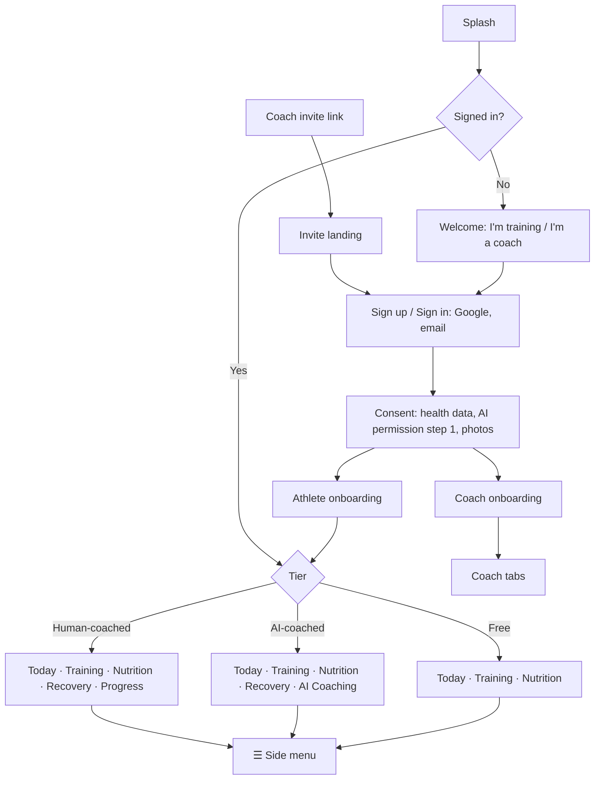

# Arcwell — Sitemap (v1)

Every screen in the v1 Android app, by role. Tier markers: **[F]** free athlete, **[P]** paid (AI) athlete, **[C]** coached athlete, **[All]** every athlete. 🔒 = shown locked to free users as an upgrade moment. AI screens are never shown to coached athletes.

## Overview

Confirmed rules are in [DECISIONS.md](../DECISIONS.md) (IDs in brackets). Labels are working names (D3 pending).

## 1. Entry and account (shared)

- Splash · Welcome · Sign up / Sign in (Google, email) · Email verification · Forgot password → reset link sent
- Invite landing (from a coach's link) · Already coached (switch coach) · AI subscriber joining a coach (cancellation step, D7a)
- Consent — health data, **AI permission step 1** (D8), photos (optional, D12)
- Open: role chosen before or after sign-up; role switching; whether invite sign-ups see the AI step

## 2. Athlete onboarding

1. Goal · 2. Experience · 3. Age, height, weight (sex: open) · 4. Injuries / limitations · 5. Training days and session length · 6. Equipment · 7. Diet type
8. Summary → [F] calorie target + starter templates (calories only, D5) · [C] connected to coach, waiting for plan (no turnaround promise)

## 3. Athlete app

### Bottom bar by tier (D2, D2a, D2b)

| Tier | Bottom bar |
|---|---|
| Free | Today · Training · Nutrition |
| AI-coached (Pro) | Today · Training · Nutrition · Recovery · AI Coaching |
| Human-coached (Pro) | Today · Training · Nutrition · Recovery · Progress |

### Today
- Today by tier (contents pending, D2d) · waiting-for-plan state [C] · notifications open from ☰

### Training
- Training landing — [F] 2–3 templates · [AI] AI plan · [C] coach's plan (T-01 to T-03; relation to menu Workouts / Programs open)
- Workout preview → active workout (set logging, rest timer, swap, notes) → summary
- Exercise detail · Workout history (also ☰ → Training → History)
- Waiting for plan [C]

### Nutrition
- Day log — [F] calories only · [AI][C] full macros
- Food search → portion picker · quick add · custom food · photo logging [AI only] · meal plan [AI] or coach's [C]
- Upgrade moment [F]

### Recovery [AI][C] — hidden for free (D4, D5a)
- Log today (sleep hours, sleep quality / score — formula open, soreness, fatigue) · Trends · First use
- Coach recovery controls: open

### AI Coaching [AI only] (D2)
- AI plan overview and structured adjustments · AI permission declined · daily limit · out-of-scope → human coach (destination open)

### Progress [C only] — combined Check-ins · Progress · Chat (D2a, D11)
- Check-ins: due · sent / awaiting feedback · overdue · check-in flow (measurements, photos optional, how the week went, review) · feedback received
- Progress switch: contents open
- Chat: text, image, PDF
- Athletes never see the coach's review tools. Past check-ins visibility: open

### Side menu ☰ (all athletes, D9)
- **Account:** profile (edit, AC-07) · units (AC-08) · help (AC-09) · subscription · my coach [C] (history access, leave coach) · privacy and permissions (photos, AI permission) · units · export my data · help · delete account · sign out
- **Notifications:** list + preferences
- **Training:** Exercises (library, T-04) · Workouts · Programs · History · Set Videos · Muscle Analytics — Pro: all (D10); Free: Programs limited to templates, others open
- **Gyms** — behaviour open
- **Physique:** Bodyweight · Measurements · Photos · Charts — free for everyone (D5)

### Subscription and trial
- Paywall (one-week trial, D6; billing at trial end open) · AI permission step 2 before purchase (proposal) · Google Play purchase · subscription details · payment problem · subscription ended (what happens to AI plan and recovery history: open)

### Coaching changes
- AI subscriber joins coach → end subscription step (refund: open) → what changed
- Leave coach → confirm (edit rights, Recovery access, photo approvals: open) → what changed (free bar)

## 4. Coach onboarding

1. Coach profile basics (name, photo, specialisations, bio)
2. Services / packages (text, shown on profile)
3. Create first plan template (or skip)
4. Share invite link (copy / WhatsApp / Instagram)
5. Coach plan info (beta: free)

## 5. Coach app

_Coach navigation below is a proposal; it has not been reviewed yet._

### Tab: Clients
- Client list — sorted by "needs attention" (K-01); client profile sections K-02, K-03, K-14 to K-18 (overdue check-in, low adherence, unread); filters: active, paused, leaving, completed
- **Client profile**
  - Overview (adherence, recent activity, weight trend)
  - Training — assigned plan, workout logs, history
  - Nutrition — meal plan, food logs, adherence
  - Recovery — logs and trends
  - Progress — measurements, photos (respecting join date / history permission)
  - Check-ins — history and replies
  - Notes (private to coach)
  - Status — change lifecycle state, end coaching
- Invite client (link, QR, share)

### Tab: Check-ins
- Inbox — submitted, overdue, reviewed
- Check-in review (answers, measurements, photos, compare with last) → text feedback
- Check-in schedule per client (day of week)

### Tab: Plans
- Training templates → **Plan builder** (weeks, days, exercises, sets/reps/rest/effort)
- Meal plan templates → **Meal plan builder** (meals, foods, quantities, totals)
- Assign template to client → customise per client
- Exercise library (browse)

### Tab: Messages
- Conversation list → chat (text, image, PDF)

### Tab: Business
- Leads — list, add, status (new, contacted, converted, lost), notes
- Invite link and QR
- Coach profile (edit) — services, specialisations, credentials (optional), transformations
- Transformations — request photo use from client → status (pending/approved/withdrawn) → export blurred before/after
- Plan and billing — current plan, client limit, pay via Razorpay link
- Settings — notifications, privacy, help, sign out

## 6. System screens (all roles)

Reusable patterns: loading (S-01), error and retry (S-02), form validation (S-03), permission denied (S-04), offline (F4-09, F7-03).

- Empty states (no clients, no workouts, no logs)
- Offline banner; workout saved locally / syncing
- Errors and retry
- Force update / maintenance
- Permission prompts (camera, photos, notifications)

## 7. Screen count (approx.)

See DESIGN.md §7 for the screen inventory and status (drawn only; none reviewed or tested).
