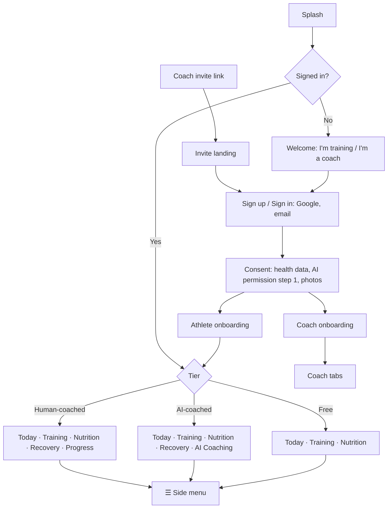

# Arcwell — Sitemap (v1)

Every screen in the v1 Android app, by role. Tier markers: **[F]** free athlete, **[P]** paid (AI) athlete, **[C]** coached athlete, **[All]** every athlete. 🔒 = shown locked to free users as an upgrade moment. AI screens are never shown to coached athletes.

## Overview

Confirmed rules are in [DECISIONS.md](../DECISIONS.md) (IDs in brackets). Labels as drawn are the v1 names (D45). Every screen below is drawn in F1–F18.

## 1. Entry and account (shared)

- Splash · Welcome (three-page hero: training, meals, recovery; D53) · Get Started → role sheet (F1-02a) · Sign up / Sign in (Google, email) · Email verification · Forgot password → reset link sent
- Invite landing (from a coach's link) · coach is full (K-26) · Already coached (switch coach) · AI subscriber joining a coach (cancellation in Google Play, D7a, D19)
- Consent — health data, **AI permission step 1** (D8), photos (optional, D12) · invite sign-ups skip the AI step (F1-05b, D44)
- One role per account; role chosen before sign-up, in the Get Started sheet (D44, D53)

## 2. Athlete onboarding

Onboarding v2 (D52): five sections on one progress bar. Screen IDs AO-xx (wireframes f1-f3, mockups hifi-mockups/onboarding-flow.html).

1. About you: gender (optional, D44) · age · height · current weight (AO-01 to AO-04)
2. Your goal: main goal · goal weight (optional) · activity level (AO-05 to AO-07)
3. Training: experience · where you train + home kit · days per week and preferred days · session length and time of day · injuries / limitations (AO-08 to AO-12)
4. Recovery (all skippable): sleep hours and times · sleep quality · stress, energy and soreness (AO-13 to AO-15)
5. Nutrition: diet type · meals per day (AO-16, AO-17)
6. Your plan → [F] building your plan → calorie target (calories only, D5) → plan preview (no AI, D44) → all set with starter workouts (D27) (AO-18 to AO-21) · [C] connected to coach, waiting for plan, no turnaround promise (AO-21b)

## 3. Athlete app

### Bottom bar by tier (D2, D2a, D2b)

| Tier | Bottom bar |
|---|---|
| Free | Today · Training · Nutrition |
| AI-coached (Pro) | Today · Training · Nutrition · Recovery · AI Coaching |
| Human-coached (Pro) | Today · Training · Nutrition · Recovery · Progress |

### Today
- Today by tier (final, D2d, D23) · waiting-for-plan state [C] · coaching paused / ending banners [C] (CS-01, CS-02) · trial-ending card [AI] (TL-01) · notifications open from ☰

### Training
- Training landing — [F] 2–3 starter workouts · [AI] AI plan · [C] coach's plan (T-01 to T-03)
- Workout preview → active workout (set logging incl. timed and bodyweight sets, rest timer, swap, notes) → summary
- Exercise detail · Workout history (also ☰ → Training → History)
- Waiting for plan [C]

### Nutrition
- Day log — [F] calories only · [AI][C] full macros
- Food search → portion picker · quick add · custom food · photo logging [AI only] · meal plan [AI] or coach's [C]
- Upgrade moment [F]

### Recovery [AI][C] — hidden for free (D4, D5a)
- Log today (sleep hours, sleep quality, 0–100 sleep score dial, soreness, fatigue) · Trends · First use
- [C] coach's sleep target and note shown on Recovery (R-04, set in K-24)

### AI Coaching [AI only] (D2)
- AI plan overview and structured adjustments · AI permission off (AI-02, AI-03) · daily limit (X-01) · plan failed (X-02) · out of scope: "I can't help with that" (AI-04, D22)

### Progress [C only] — combined Check-ins · Progress · Chat (D2a, D11)
- Check-ins: due · sent / awaiting feedback · overdue · check-in flow (measurements, photos optional, how the week went, review) · feedback received
- Progress switch: timeline of past check-ins and coach feedback → past check-in (CP-04, CP-06, D16)
- Chat: text, image, PDF
- Athletes never see the coach's review tools.

### Side menu ☰ (all athletes, D9)
- **Account:** profile (AC-07) · units, kg only (AC-08) · subscription · my coach [C] (history access AC-10, leave coach) · privacy and permissions (photos, AI permission) · export my data · help (AC-09) · delete account · sign out
- **Notifications:** list + preferences
- **Training:** Exercises (T-04, free) · Workouts (TR-01 free templates / TR-02 Pro, create TR-03) · Programs (TR-04 Pro / TR-05 locked) · History (F4-13, free) · Muscle Analytics (TR-06 Pro / TR-07 locked) — D13, D25. No Set Videos (D14).
- **Gyms** — read-only map and directory (G-01, G-02), free (D15, D25)
- **Physique:** Bodyweight · Measurements · Photos · Charts — free for everyone (D5)

### Subscription and trial
- Paywall (one-week trial, D6) · AI permission step 2 before purchase (D35) · Google Play purchase · subscription details · payment problem · trial-ending reminder (TL-01) · trial ended, not paid → Free (TL-02, D17) · subscription ended (AI plan read-only, recovery history kept: D32, D33)

### Coaching changes
- AI subscriber joins coach → cancel in Google Play (refunds out of app, D19) → what changed
- Leave coach → confirm (plan read-only, Recovery hidden, photo choice: D21, D38) → what changed (free bar)
- Coach marks Completed or deletes account → same outcome as leaving (K-30, K-29, D39, D42)

## 4. Coach onboarding

Same style as athlete onboarding (D52). Screen IDs CO-xx (wireframes f2, mockups hifi-mockups/coach-onboarding.html).

1. Coach sign-up (CO-01, drawn as K-19), what you get and coach agreement (CO-02, CO-03)
2. Your coaching: how you coach · roughly how many clients (CO-04, CO-05)
3. Profile: name, photo, city · specialisations (up to 3) · bio, Instagram, years, certifications (optional) (CO-06 to CO-08)
4. Services / packages (text, shown on profile) (CO-09)
5. Create first plan template, or skip (CO-10)
6. Share invite link: copy / WhatsApp / Instagram / QR (CO-11) → ready to coach (CO-12)
7. Clients list with setup checklist, first clients, assign plan (CO-13 to CO-15). Coach plan info (beta: free) is in Plan and billing (K-13).

## 5. Coach app

_Coach navigation below is final for v1 (D23)._

### Tab: Clients
- Client list — sorted by "needs attention" (K-01); client profile sections K-02, K-03, K-14 to K-18 (overdue check-in, low adherence, unread); filters: active, paused, leaving, completed
- **Client profile**
  - Overview (adherence, recent activity, weight trend)
  - Training — assigned plan, workout logs, history
  - Nutrition — meal plan, food logs, adherence
  - Recovery — logs and trends, sleep target and note (K-24)
  - Progress — measurements, photos (respecting join date / history permission)
  - Check-ins — history and replies
  - Notes (private to coach)
  - Status — change lifecycle state (effects D39), complete a client (K-30)
- Invite client (link, QR, share)

### Tab: Check-ins
- Inbox — submitted, overdue, reviewed
- Check-in review (answers, measurements, photos, compare with last) → text feedback
- Check-in schedule per client (day of week)

### Tab: Plans
- Training templates → **Plan builder** (weeks, days, exercises, sets/reps/rest/effort)
- Meal plan templates → **Meal plan builder** (meals, foods, quantities, totals)
- Assign template to client → customise per client
- Exercise library (browse; K-23 proposes it as a third Plans tab)

### Tab: Messages
- Conversation list → chat (text, image, PDF; viewers X-05, X-06)

### Tab: Business
- Leads — list, add, status (new, contacted, converted, lost), notes
- Invite link and QR
- Coach profile (edit) — services, specialisations, certifications (optional, self-reported, D43), transformations. Audience: invite page and own clients only
- Transformations — request photo use from client → status (pending/approved/withdrawn) → export blurred before/after
- Plan and billing — current plan, client limit (K-25), billing lapse (K-27), pay via Razorpay link
- Settings — notifications, privacy, help, export, delete coach account (K-28), sign out

## 6. System screens (all roles)

Reusable patterns: loading (S-01), error and retry (S-02), form validation (S-03), permission denied (S-04), offline (F4-09, F7-03), force update (S-05), maintenance (S-06). Empty states E-01 to E-08 and other missing states X-01 to X-10 are in F16.

- Empty states (no clients, no workouts, no logs)
- Offline banner; workout saved locally / syncing
- Errors and retry
- Force update / maintenance
- Permission prompts (camera, photos, notifications)

## 7. Screen count (approx.)

See DESIGN.md §7 for the screen inventory and status (drawn only; none reviewed or tested).
