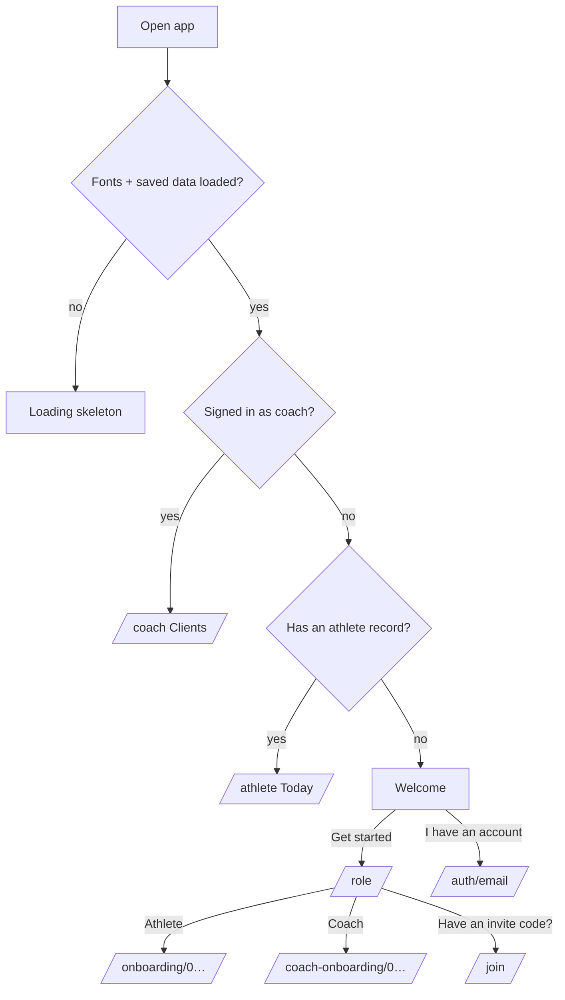
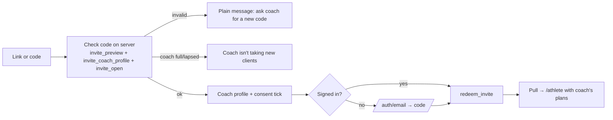

# 03 · App Flow Document

**Updated:** 14 November 2026 (to D111). Describes every route, how people move between them, and exactly what happens on each important tap or submit: on the phone (store) and on the server (Supabase). Route files live in `app/src/app/`.

The store: `CoachDataProvider`. Sync: `features/sync`, D107.

- **Accounts on, signed in:** every store change is saved to the server about 1.2 s after it settles. Screens refresh every 20 s, when the app comes back to the foreground, and at once on new messages.
- **Sample mode (no backend) or signed out:** the same screens run on built-in sample data saved on the phone.

---

## 1. Entry routing (`/`, `app/index.tsx`)

| Tap | What happens |
|---|---|
| **Get started** | Opens `/role` |
| **I have an account** | Clears any pending sign-up and opens `/auth/email` (sign in). Sample builds go straight in |
| **Role: Athlete → Continue** | Opens athlete onboarding step 0 |
| **Role: Coach → Continue** | Opens coach onboarding step 0 |
| **"Have an invite code from your coach?"** | Opens `/join` |

## 2. Sign-in and sign-up (`/auth/email` → `/auth/code`)

1. **Email → Send code:** `supabase.auth.signInWithOtp`. If a sign-up is pending, the account is created; otherwise only existing accounts get a code. Errors are shown in plain words: rate limit, bad email, no account ("Tap Get started").
2. **Code → 6 digits typed:** `verifyOtp` runs.
   - **A sign-up was pending:**
     - the profile row is inserted with its role (one role per account; a role mismatch signs out with a message);
     - a health-data consent row is inserted if the person ticked it;
     - the pending step runs (finish onboarding, redeem the invite, and so on).
   - **Signing in:**
     - a coach goes to `/coach`;
     - an athlete with a stored profile goes to `/athlete`;
     - an athlete with no stored profile goes to onboarding;
     - no profile at all goes to `/role`.
3. **First sync after sign-in:** the account's data is pulled.
   - **New account:** what onboarding built on the phone is kept and saved (adoption).
   - **Coach:** their general invite (code from name and id) is created.

## 3. Self-guided athlete (D57)

`/onboarding/0…33` (five sections; Skip on optional steps) → `/onboarding/ready` ("Your plan is ready") → `/onboarding/save` → `/auth/email` → `/auth/code` → `/onboarding/pro` (paywall) → `/athlete`

| Step | Tap | Phone | Server |
|---|---|---|---|
| Each question | **Next** (off until answered) | Answer saved in onboarding state | — |
| Ready | **Save my plan** | Plan built by the rules (`selfPlan`) | — |
| Save | Tick consent (required, "18 or older"), optional photo consent → **Continue with email** | `auth.begin({role: athlete, consent})` | After the code: profile and consent rows |
| Paywall | **Start 7-day free trial** → AI consent sheet → **Allow and start** | Self record created (tier Plus), AI consent stored | `consents(ai)`. Demo builds call `demo-billing`, which writes `subscriptions` (pro, trial); real builds go through the Play purchase and RevenueCat webhook. First sync saves the plans and profile |
| Paywall | **Continue with the free plan** | Self record (tier free) | First sync saves the plans and profile |

## 4. Coach

**Coach onboarding:**
- `/coach-onboarding/0…` covers what you get, the coach agreement (Terms, 18+), how you coach, profile, services and first template (Arcwell starter, from scratch, or spreadsheet import).
- `/coach-onboarding/ready` → **Go to Clients**: sign up by email code, then the profile is saved, the first template created and `/coach` opens.
- If "scratch" was picked, the template builder opens on top. If it was an import with rows to fix, `/coach/template/import` opens on top.

**Coach tabs (`/coach/(tabs)`):** Clients · Check-ins · Plans · Messages · Business. The button above the tab bar is always the next most useful step, such as "Review 2 check-ins".

### 4.1 Add a client and invite them (D56)

`Clients → Add a client` (`/coach/add-client`) → `/coach/client/<id>` → plan screens → **Create invite** → `/coach/invite/<id>`

| Tap | Phone | Server |
|---|---|---|
| **Continue to plans** (name required) | Pending client in the store | Saved at once as a personal invite (`invites`, code made from the client id, payload = details, plans, notes) |
| Training program → pick template or Blank → **Save training program** | Program on the client; a new pick restarts at week 1 | `invites.payload.plans.training` updated |
| Nutrition plan → **Use these** / adjust → **Save** | Targets and example day | `invites.payload.plans.nutrition` |
| Recovery protocol → **Save** | Sleep target, bed and wake window, rest days | `invites.payload.plans.recovery` |
| **Create invite** (enabled when all three plans exist) | Shows code and link `arcwell.app/j/<code>` | `payload.sent = true` |
| Send on WhatsApp / Copy link / More | System share sheet or clipboard | — |

### 4.2 After the client joins

- On its next refresh, the coach's list replaces the pending client with the real one.
- The client's plans and the coach's notes were copied when the invite was redeemed.
- `/coach/client/<id>` has Overview (adherence, weight trend, this week), Training, Nutrition and Recovery. The plan rows open the builders.

| Tap | Server |
|---|---|
| Edit any plan → Save | `plans` row upserted for that kind. The athlete gets a "plan updated" notice (`programUpdatedAt`) and a push (`notify plan`) |
| Status → Paused / Leaving | `plans.meta.status`, which the athlete sees as a banner |
| Status → **Complete** | `end_link(client, 'completed')`. Access ends at once; the client becomes a free athlete with their history |
| Remove (pending client) | Invite revoked (`revoked_at`) |
| Notes, account, CRM fields | `coach_client_notes` (coach only) |
| Ask for a transformation | `transformations` insert (status waiting); only the athlete can approve |
| Enhanced → ask | `enhanced.payload.requestedAt`; the coach records only after the athlete's yes |

### 4.3 Check-ins and messages

- **Check-ins tab:**
  - filters: To review, Overdue, Reviewed;
  - open a check-in (`/coach/check-in/<id>`), pick a quick reply or type one, **Send feedback**;
  - this updates `check_ins.reply` and `reviewed_at` (the coach can't edit the athlete's part) and sends `notify check_in_reply`.
- **Messages tab:**
  - open a client chat (`/coach/chat/<id>`); opening it marks their messages read (`read_at`);
  - **Send:** the message is inserted with a deterministic id (no duplicates), attachments go to `athlete-files/<client>/chat/`, and `notify message` runs;
  - the other side receives it live through Realtime.

### 4.4 Business

- **Tabs:** Overview, Leads, Instagram, Clients.
- **Leads:** stored in `leads`, coach only.
- **QR button:** opens `/coach/invite-link`, showing the general invite link `arcwell.app/j/<coach code>` and "Client spots X of limit" (from `coach_billing`).

### 4.5 Billing (coach)

`/coach/menu/billing` shows plan status from `coach_billing` (written only by the Razorpay webhook):
- **grace:** a banner;
- **lapsed:** inviting and plan changes are blocked by the server (D41);
- **full:** the invite page says the coach isn't taking clients (D40).

## 5. Joining a coach (`/join`, `/join/<code>`)

- **Personal invite:** copies the plans and notes, sets the invited name, starts the profile with the coach's details, and is used up.
- **General invite:** links the athlete; the coach then builds their plans.
- **Report this profile** (on the invite page's coach profile): opens the person's mail app addressed to support, with the coach named (D-05).
- **Errors:**
  - already coached: "Leave them first";
  - invite used or expired: "Ask for a new one";
  - coach full or lapsed: refused.

## 6. Athlete app

**Tabs (`/athlete/(tabs)`):** Today · Training · Nutrition · Recovery, plus the + quick-log button.
- The Progress button sits at the top right of every tab (D101).
- ☰ opens the menu.
- On the free plan, Recovery shows the locked Plus page.

### 6.1 Today

| Element | Tap | Result |
|---|---|---|
| Coach card (coached) | Opens `/athlete/chat` | Messages marked read when opened |
| Weekly check-in → **Check in** | `/athlete/weekly-check-in` | See 6.5 |
| Morning to-do (sunlight, water, caffeine, movement) | Tick | `day_logs` (habits, water) |
| ▶ (round play button, D100) | `/athlete/workout/preview/<day>` | See 6.2 |
| + | Quick log sheet: workout, food, weight, check-in | Opens the matching screen |
| AI button (Plus only) | `/athlete/ai` | See 6.6 |

### 6.2 Workout

`Training → Coach plan / Arcwell plan / template → Start` → `/athlete/workout/preview/<id>` → **Start workout** → `/athlete/workout` (logger)

| Tap | Result |
|---|---|
| Set ✓ | Set marked done; rest timer starts; the workout in progress is saved on the phone (survives app kill) |
| Edit kg, reps or RPE | Keypad; pre-filled from last time |
| Swap exercise | Alternatives from the library. Coached swaps are for today only; self-guided can apply them to the plan |
| Minimise (⌄) | A bar appears above the tab bar; tap it to return, or the bin to discard (confirm) |
| **Finish** with sets not ticked | Sheet: Mark them done and finish / Finish without them / Keep going |
| **Finish** | Session saved urgently (`workouts` row); summary `/athlete/workout/summary/<id>` with effort and note; the coach sees it on their next refresh |

### 6.3 Nutrition

| Tap | Result |
|---|---|
| + on a meal → `/athlete/food/add` | Search (Hindi names and spellings), Recent, Frequent, My foods |
| + on a food | Logged at its last-used portion (`food_logs`) |
| A food row | `/athlete/food/portion`: katori, piece, grams |
| Camera (Plus) → `/athlete/food/photo` | Photo shrunk to ~1024 px → `scan-meal` function (entitled + cap) → foods to check → **Log** |
| Meal plan → **Ate this** | Plan meal logged as foods |
| Create a food / Quick add | `my_foods` or a quick calories entry |

### 6.4 Recovery (Plus and coached)

- **Tabs:** Overview, Sleep, Recovery, Strain.
- **Morning check-in** (`/athlete/recovery/check-in`): saved as `day_logs` (recovery) and feeds the recovery score.
- **Planner, protocols, breathe and activity:** stored as `day_logs` (protocols, activity).
- **Connect a device** (`/athlete/recovery/connect`): Health Connect, which needs a development build.

### 6.5 Weekly check-in (coached)

Three steps: Measurements → About you / the week → Review → **Send**.

- **Photos:** the photo step is skipped when photo consent is off.
- **On send:** `check_ins` insert, a coach notification (`notify check_in`), and the coach's Check-ins shows "To review".
- **Coach reply:** shows in Progress → Check-ins and as a notification "Coach replied".

### 6.6 AI coach (Plus only; coached athletes are redirected away and refused by the server)

| Screen | Tap | Server |
|---|---|---|
| `/athlete/ai` chat | Ask (chip or typed) · **Clear chat** | `ai-coach` chat: entitled → cap (40/day) → out-of-scope declined → model or rules → checked → reply with sources. Today's chat is saved on the phone only and comes back when the screen reopens; it clears at midnight, on Clear chat, sign-out, deletion or AI off (D109) |
| `/athlete/assistant/tailor` | Type what's different → **Suggest a change**, or pick a chip | `ai-coach` tailor: kinds from the fixed list → the rules change today's workout → **Apply to today** (today only) |
| `/athlete/assistant/review` | Open | `ai-coach` review: up to 3 checked suggestions, each opening a tool |
| `/athlete/assistant/plan` · `meal-plan` | Build → **Use this plan** | Rules on the phone; saved as plans when accepted |

**Errors:**
- daily limit: "That's today's questions used";
- not entitled: "part of Arcwell Plus";
- offline: "Can't reach the coach right now".

### 6.7 Menu and account (`/athlete/menu`)

| Item | Result |
|---|---|
| Profile | Edits the athlete profile (`athlete_profiles`) and display name |
| My coach → **Report this profile** | Opens the mail app to support with the coach named; if no mail app opens, shows the address (D-05) |
| My coach → **Leave** | `end_link(coach, 'left')`; becomes a free athlete with their history and the coach's plan, read-only; optionally withdraws approved photos |
| Privacy and permissions | AI on or off (`consents` ai), photos on or off, history sharing (`share_history`), policy links |
| Export my data | `export_my_data()` → JSON download (web) or share sheet (phone) |
| Delete account | Type DELETE → `delete-account` function (files removed, account deleted, everything cascades) → signed out to Welcome |
| Notifications | Switches per type, honoured on the server for every push; a push token is registered after permission (development build) |
| Reminders | Workout time (default 18:00, on) drives the daily workout push; the check-in push goes at 09:00 on the coach's check-in day, unless already checked in or paused (D111) |
| Help, legal | `/legal/<doc>` (works offline and before sign-up) |
| Sign out | `auth.signOut` → store returns to the sample → Welcome |

## 7. States every screen handles

| State | Behaviour |
|---|---|
| Loading | Skeleton (`LoadingScreen`), never a spinner |
| Error | `ScreenError` ("Nothing you logged was lost") with Try again |
| Offline | `OfflineBanner`; changes are kept and saved when back (D107) |
| Not found | `NotFound` with Back (deleted item or old link) |
| Not allowed | Redirect (for example a coached athlete to an AI route) and refused by the server |
| Empty | Plain next step (for example "Add a new template", "Coach X is building your plan") |
| Confirm destructive | `lib/alert` (works on web): delete, discard, remove, sign out |

## 8. Route inventory

- **Entry:** `/`, `/role`, `/auth/email`, `/auth/code`, `/join`, `/join/[code]`, `/join/coach`, `/legal/[doc]`, `/science`, `/system/[state]`.
- **Athlete onboarding:** `/onboarding/[step]`, `ready`, `save`, `pro`, `building`, `connected`.
- **Athlete:**
  - **tabs:** `(tabs)` Today, `nutrition`, `recovery`, `training`;
  - **training:** `workout`, `workout/preview/[dayId]`, `workout/summary/[id]`, `plan`, `programs`, `programs/[key]`, `routine/[id]`, `history`, `history/[id]`, `analytics`, `calendar`, `exercises`, `exercises/[name]`;
  - **cardio:** `cardio`, `cardio/session`, `cardio/test`;
  - **race:** `race`, `race/setup`, `race/sim/[id]`, `race/sim/live`, `race/sim/new`;
  - **food:** `food/add`, `food/new`, `food/photo`, `food/plan`, `food/portion`, `food/quick`;
  - **recovery:** `recovery/activity`, `breathe`, `check-in`, `connect`, `cycle`, `health`, `outlook`, `planner`, `protocol/[id]`, `protocols`, `stress`;
  - **habits:** `habits`, `habits/[id]`, `habits/plans`;
  - **progress:** `progress`, `chat`, `weekly-check-in`, `check-in/[id]`, `photos`, `photos/review/[id]`, `physique/bodyweight`, `charts`, `measurements`, `photos`;
  - **AI:** `ai`, `assistant/meal-plan`, `nutrition`, `plan`, `review`, `tailor`;
  - **menu:** `menu`, `menu/account`, `coach`, `delete`, `export`, `help`, `history-access`, `leave`, `notifications`, `privacy`, `profile`, `reminders`, `shows`, `units`;
  - **other:** `subscription`, `switch/[step]`, `gyms`, `gyms/[id]`, `enhanced`.
- **Coach onboarding:** `/coach-onboarding/[step]`, `ready`.
- **Coach:**
  - **tabs:** `(tabs)` Clients, `business`, `check-ins`, `messages`, `plans`;
  - **clients:** `add-client`, `client/[id]`, `client/check-ins/[id]`, `client/notes/[id]`, `client/progress/[id]`, `client/status/[id]`, `account/[id]`, `chat/[id]`, `check-in/[id]`, `broadcast`;
  - **plans:** `plan/nutrition/[id]`, `plan/recovery/[id]`, `plan/supplements/[id]`, `plan/training/[id]`, `template/assign/[id]`, `template/import`, `template/meals/[id]`, `template/training/[id]`, `stack/[id]`, `stack/assign/[id]`, `exercises`, `exercises/[name]`, `exercises/new`;
  - **invites:** `invite/[id]`, `invite-link`;
  - **other:** `enhanced/[id]`, `lead/[id]`, `transformations`, `transformations/[id]`, `transformations/request/[id]`;
  - **menu:** `menu`, `menu/billing`, `delete-account`, `export`, `help`, `profile`, `settings`.
- **Developer only (unlinked):** `/dev/gallery`, `/dev/tokens`.
