# 05 · Backend Schema Document

**Updated:** 14 November 2026 (to D111). The database is **Supabase Postgres 17**, defined only by migrations in `supabase/migrations/` and proven by pgTAP tests in `supabase/tests/` (201 tests, including schema hygiene checks in `008_schema_hygiene`). The column tables in section 7 are generated from the live local database. Regenerate them after any migration.

## 1. Rules for every table (no exceptions)

1. **A migration, never a hand edit.** Create it with `npx supabase migration new <name>`. Never change a migration once it's pushed; fix forward with a new one.
2. **RLS on**, with explicit policies and **least-privilege grants**:
   - `revoke all` from anon and authenticated, then grant only the columns that may be inserted or updated;
   - never grant update on primary keys.
3. **pgTAP tests** that prove three things:
   - a coach can't see another coach's clients;
   - a coach sees a client's rows only from the join date, unless history is shared;
   - access ends when the link ends.

   They also prove who may write.
4. **Ownership columns:** `athlete_id` or `coach_id` (or `owner_id`), defaulting to `auth.uid()`, referencing `profiles(id) on delete cascade`.
5. **Dated logs get their own row** with a timestamp (`at`) or a local day (`day`), so the join-date rule (`coach_can_read` / `coach_can_read_day`) applies. Never put dated logs inside a profile document.
6. **Payloads:** detail that the app owns is stored as `payload jsonb` (checked `jsonb_typeof = 'object'`), shaped like the app's TypeScript types. Anything the database must filter, join or enforce gets a real column (ids, dates, status, kind, code).
7. **Primary keys:** per-owner composite keys `(athlete_id, id)` with app-generated text ids, so offline creation never collides. Shared rows use uuid keys (`messages`, `coach_clients`, `invites`).
8. **Functions:** `security definer` only when needed, always `set search_path = ''` with schema-qualified names, and execute revoked from `public, anon` unless meant for them.
9. **Every table has `updated_at`** (or is append-only), set by a trigger.
10. **No health data in logs, errors or function output beyond what the caller may read.**
11. **Every foreign key has an index** (account deletion cascades through them, and lookups use them). Enforced by `supabase/tests/008_schema_hygiene.test.sql`, which also fails if a table lacks RLS or a policy, if signed-out users get any table privilege, or if a security-definer function doesn't pin an empty `search_path`.

## 2. Entity overview

```mermaid
erDiagram
  auth_users ||--|| profiles : "1:1"
  profiles ||--o{ consents : gives
  profiles ||--o{ coach_clients : "coach / client"
  profiles ||--o{ invites : "coach creates"
  profiles ||--o| athlete_profiles : has
  profiles ||--o| coach_profiles : has
  profiles ||--o| athlete_preferences : has
  profiles ||--o{ plans : "athlete (5 kinds)"
  profiles ||--o| enhanced : athlete
  profiles ||--o{ coach_client_notes : "coach about client"
  profiles ||--o{ templates : coach
  profiles ||--o{ leads : coach
  profiles ||--o{ custom_exercises : owner
  profiles ||--o{ workouts : athlete
  profiles ||--o{ routines : athlete
  profiles ||--o{ food_logs : athlete
  profiles ||--o{ my_foods : athlete
  profiles ||--o{ check_ins : athlete
  profiles ||--o{ messages : "coach + athlete"
  profiles ||--o{ body_logs : athlete
  profiles ||--o{ progress_photos : athlete
  profiles ||--o{ day_logs : athlete
  profiles ||--o{ transformations : "coach asks / athlete decides"
  profiles ||--o| subscriptions : athlete
  profiles ||--o| coach_billing : coach
  profiles ||--o{ ai_usage : athlete
  profiles ||--o{ push_tokens : device
  profiles ||--o{ reminder_sends : athlete
  auth_users ||--o{ call_usage : "any account"
```

## 3. Tables by area: who reads, who writes

| Area | Table | Read | Write | Migration |
|---|---|---|---|---|
| Accounts | `profiles` | self, current coach, current clients | self (display name only; role fixed) | auth_foundations |
| | `consents` | self | self, append-only (latest per purpose wins) | auth_foundations |
| | `coach_clients` | both sides | functions only (`redeem_invite`, `end_link`, `share_history`) | auth_foundations |
| | `invites` | coach | coach (payload, revoke); `redeem_invite` uses it up | b1_invites_preferences |
| | `athlete_profiles` | athlete, current coach | athlete | b1_profiles_notes |
| | `coach_profiles` | coach, current clients (invite page via function) | coach | b1_profiles_notes |
| | `coach_client_notes` | coach | coach (needs a past or present link) | b1_profiles_notes |
| | `athlete_preferences` | athlete, current coach | athlete | b1_invites_preferences |
| Plans | `plans` (training, nutrition, recovery, supplements, meta) | athlete, current coach | `can_write_plans`: the current coach in good standing, or the self-guided athlete | b2_plans_templates |
| | `enhanced` | athlete, current coach | athlete (consent); coach records only after consent | b2_plans_templates |
| | `templates` (training, meals, stack) | coach | coach | b2_plans_templates |
| | `leads` | coach | coach | b2_plans_templates |
| | `custom_exercises` | owner, current coach or clients | owner | b2_plans_templates |
| Logs | `workouts` (at) | athlete, coach from join date | athlete | b3_b4_logs |
| | `routines` | athlete, current coach | athlete | b3_b4_logs |
| | `food_logs` (day) | athlete, coach from join day | athlete | b3_b4_logs |
| | `my_foods` | athlete | athlete | b3_b4_logs |
| Coaching | `check_ins` (at) | athlete, coach from join date | athlete (check-in); coach (reply, reviewed_at only) | b5_checkins_chat_files |
| | `messages` | athlete; coach (their thread, from join date) | sender, only while linked; recipient sets `read_at` | b5 + messages_client_id |
| | `push_tokens` | owner | owner | b5 |
| Progress | `body_logs` (weight, measure; day) | athlete, coach from join day | athlete | b6_progress_recovery |
| | `progress_photos` (day) | athlete, coach from join day | athlete | b6 |
| | `day_logs` (recovery, device, water, habits, protocols, activity; day) | athlete, coach from join day | athlete | b6 |
| | `transformations` | athlete; coach while linked or approved | coach asks (waiting); athlete decides | b6 |
| Billing and AI | `subscriptions` | athlete | revenuecat-webhook or demo-billing (service role) | ai_entitlement_usage + b7 |
| | `coach_billing` | coach | razorpay-webhook (service role) | b7_billing |
| | `ai_usage` | athlete | `ai_try_use()` only | ai_entitlement_usage |
| Jobs and limits | `call_usage` (per user, function, UTC day; keyed to the auth user so an unfinished sign-up can still delete itself) | self | `call_try_use()` only | scheduled_jobs |
| | `reminder_sends` (per user, kind, India-time day) | self | `claim_reminders()` only (service role) | scheduled_jobs |
| Storage | bucket `athlete-files` (`<athlete>/<area>/<file>`) | athlete; current coach | athlete; coach adds only into `chat/` | b5 |

## 4. Payload shapes (app TypeScript types)

| Table.payload | Shape (type in app) |
|---|---|
| `workouts` | `Session` (features/athlete/training.ts): name, minutes, sets per exercise (kg, reps, seconds, km, rpe, warmup), bests, effort, note |
| `food_logs` | `FoodLog` (features/athlete/foods.ts): date, meal, name, qty, unit, grams, source, macros {kcal, p, c, f}, at (minute) |
| `plans.training` | `{program: TrainingProgram, programStart, programUpdatedAt}` |
| `plans.nutrition` | `{plan: NutritionPlan}` (kcal, protein, carbs, fat, meals with items) |
| `plans.recovery` | `{protocol: RecoveryProtocol}` (sleepH, bed, wake, restDays, note) |
| `plans.supplements` | `{items: Supplement[]}` |
| `plans.meta` | plan names, checkInDay, competitive, status, statusUntil, statusNote, endedBy |
| `check_ins` | `CheckIn` without reply and reviewed (week, weightKg, scores, wins, struggles, photos {front, side, back} as stored paths) |
| `athlete_profiles` | goal, answers, basics, profile, selfAnswers, photo, athleteSettings, targetKg, phone, recoveryDevice. **Never logs** |
| `coach_profiles` | `CoachProfile` and `settings` (billing and limit come from `coach_billing`) |
| `invites` | `{clientId, sent, client {goal, basics, phone, targetKg, answers}, plans {…}, notes {…, name}}` |
| `day_logs` | recovery: `WellnessLog`; activity: `{items: DayActivity[]}`; protocols: `{ids}`; water: `{ml}` |
| `body_logs` | weight: `{kg}`; measure: `{values}` |
| `progress_photos` | `{pose, uri: "sb:athlete-files/<path>"}` |
| files in payloads | Always the stored path `sb:athlete-files/<path>`, never a signed URL or a device path |

The mapping between the store and rows is `app/src/features/sync/map.ts` (unit-tested).

## 5. Access helper functions

| Function | Purpose |
|---|---|
| `is_active_coach_of(client)` / `is_active_client_of(coach)` | Live-link checks used by policies |
| `coach_can_read(client, at)` / `coach_can_read_day(client, day)` | Join-date rule (IST calendar day for day rows) |
| `can_write_plans(athlete)` | Current coach in good standing, or the self-guided athlete |
| `has_consent(purpose)` | Latest consent per purpose |
| `ai_entitled()` / `ai_try_use(feature, cap)` / `plus_current(uid)` | Plus, AI consent, never coached; daily caps |
| `athlete_tier()` | coached, pro or free, from the database |
| `coach_in_good_standing(coach)` / `coach_has_room(coach)` | D41 and D40 |
| `invite_preview`, `invite_coach_profile`, `invite_open` (anon allowed) · `invite_details` (signed-in athlete) | Invite page before and after sign-up |
| `redeem_invite(code)` | Link, then hand over plans, notes, name and details (personal invites) |
| `end_link(other, reason)` / `end_coaching(link, reason)` | Leave, complete or remove |
| `share_history(bool)` / `set_history_access(link, from)` | Athlete's history switch |
| `export_my_data()` | Everything about the caller (invoker rights, so RLS applies) |
| `call_try_use(fn, cap)` | Daily cap for non-AI functions (`notify` 300, `delete-account` 5) |
| `claim_reminders(now)` (service role only) | The workout and check-in reminders due in this 15-minute slot, honouring the athlete's switches, reminder time and paused status; records each so a rerun never sends twice |
| `purge_expired(now)` (service role only) | The retention job (section 6) |
| `run_cron_call(job)` (pg_cron only) | Calls the `cron` Edge Function with the URL and secret from Vault; does nothing if either is missing |
| `storage_owner(name)` | Folder owner for storage policies |
| Guards: `check_ins_guard`, `messages_guard`, `enhanced_guard`, `transformations_guard`, `plans_stamp`, `*_check`, `touch_updated_at` | Who may change what, inside a row |

## 6. Retention and deletion

- **Deleting an account:** the `delete-account` function removes the person's files, then their auth user. Every table cascades from it.
- **Coach deletes their account:** `coach_clients` rows cascade, so the links end. Clients keep their own rows.
- **Retention promised in the Privacy Policy:** 30 days to clear live systems, 90 days to clear backups (D111):
  - account deletion is immediate (above), so live data is gone the same day;
  - **daily purge job** (`arcwell-purge`, pg_cron, 03:00 India time): `purge_expired()` deletes AI and call counters and reminder logs older than 30 days, unused invites 30 days after they expired or were withdrawn, and the copied client details on used invites after 30 days; then the `cron` function removes any files in storage whose account no longer exists;
  - **backups** are Supabase's own: none on the free plan, 7 days of daily backups on Pro (up to 28 days with point-in-time recovery), all well inside 90 days.
- **Scheduled jobs (pg_cron):** `arcwell-reminders` every 15 minutes and `arcwell-purge` daily. Both call the `cron` Edge Function through `run_cron_call()`, which needs the Vault secrets `project_url` and `cron_secret` (doc 10).

## 7. Columns (generated)

#### `ai_usage`

| Column | Type | Null | Default |
|---|---|---|---|
| user_id | uuid | no |  |
| day | date | no | `((now() AT TIME ZONE 'utc'::text))::date` |
| feature | text | no |  |
| count | integer | no | `0` |

#### `athlete_preferences`

| Column | Type | Null | Default |
|---|---|---|---|
| athlete_id | uuid | no | `auth.uid()` |
| modules | ARRAY | no | `ARRAY['morning'::text]` |
| cardio_modalities | ARRAY | no | `ARRAY['bike'::text, 'rower'::text]` |
| cardio_days | ARRAY | no | `'{}'::smallint[]` |
| hr_max_override | smallint | yes |  |
| resting_hr | smallint | yes |  |
| habit_nudges | smallint | no | `2` |
| updated_at | timestamptz | no | `now()` |

#### `athlete_profiles`

| Column | Type | Null | Default |
|---|---|---|---|
| athlete_id | uuid | no | `auth.uid()` |
| payload | jsonb | no | `'{}'::jsonb` |
| updated_at | timestamptz | no | `now()` |

#### `body_logs`

| Column | Type | Null | Default |
|---|---|---|---|
| athlete_id | uuid | no | `auth.uid()` |
| id | text | no |  |
| kind | text | no |  |
| day | date | no |  |
| payload | jsonb | no |  |
| updated_at | timestamptz | no | `now()` |

#### `call_usage`

| Column | Type | Null | Default |
|---|---|---|---|
| user_id | uuid | no |  |
| day | date | no | `((now() AT TIME ZONE 'utc'::text))::date` |
| fn | text | no |  |
| count | integer | no | `0` |

#### `check_ins`

| Column | Type | Null | Default |
|---|---|---|---|
| athlete_id | uuid | no | `auth.uid()` |
| id | text | no |  |
| at | timestamptz | no | `now()` |
| payload | jsonb | no |  |
| reply | text | yes |  |
| reviewed_at | timestamptz | yes |  |
| updated_at | timestamptz | no | `now()` |

#### `coach_billing`

| Column | Type | Null | Default |
|---|---|---|---|
| coach_id | uuid | no |  |
| status | text | no | `'active'::text` |
| client_limit | integer | no | `40` |
| plan | text | yes |  |
| razorpay_subscription_id | text | yes |  |
| current_period_end | timestamptz | yes |  |
| last_event_at | timestamptz | yes |  |
| updated_at | timestamptz | no | `now()` |

#### `coach_client_notes`

| Column | Type | Null | Default |
|---|---|---|---|
| coach_id | uuid | no | `auth.uid()` |
| client_id | uuid | no |  |
| payload | jsonb | no | `'{}'::jsonb` |
| updated_at | timestamptz | no | `now()` |

#### `coach_clients`

| Column | Type | Null | Default |
|---|---|---|---|
| id | uuid | no | `gen_random_uuid()` |
| coach_id | uuid | no |  |
| client_id | uuid | no |  |
| joined_at | timestamptz | no | `now()` |
| history_from | timestamptz | yes |  |
| ended_at | timestamptz | yes |  |
| end_reason | text | yes |  |
| created_at | timestamptz | no | `now()` |

#### `coach_profiles`

| Column | Type | Null | Default |
|---|---|---|---|
| coach_id | uuid | no | `auth.uid()` |
| payload | jsonb | no | `'{}'::jsonb` |
| updated_at | timestamptz | no | `now()` |

#### `consents`

| Column | Type | Null | Default |
|---|---|---|---|
| id | bigint | no |  |
| user_id | uuid | no | `auth.uid()` |
| purpose | text | no |  |
| granted | boolean | no |  |
| policy_version | text | no |  |
| created_at | timestamptz | no | `now()` |

#### `custom_exercises`

| Column | Type | Null | Default |
|---|---|---|---|
| owner_id | uuid | no | `auth.uid()` |
| id | text | no |  |
| payload | jsonb | no |  |
| updated_at | timestamptz | no | `now()` |

#### `day_logs`

| Column | Type | Null | Default |
|---|---|---|---|
| athlete_id | uuid | no | `auth.uid()` |
| area | text | no |  |
| day | date | no |  |
| payload | jsonb | no |  |
| updated_at | timestamptz | no | `now()` |

#### `enhanced`

| Column | Type | Null | Default |
|---|---|---|---|
| athlete_id | uuid | no |  |
| consent_at | timestamptz | yes |  |
| payload | jsonb | no | `'{}'::jsonb` |
| updated_at | timestamptz | no | `now()` |

#### `food_logs`

| Column | Type | Null | Default |
|---|---|---|---|
| athlete_id | uuid | no | `auth.uid()` |
| id | text | no |  |
| day | date | no |  |
| payload | jsonb | no |  |
| updated_at | timestamptz | no | `now()` |

#### `invites`

| Column | Type | Null | Default |
|---|---|---|---|
| id | uuid | no | `gen_random_uuid()` |
| coach_id | uuid | no | `auth.uid()` |
| kind | text | no |  |
| code | text | no | `upper(substr(replace((gen_random_uuid())::text, '-'::text…` |
| client_name | text | yes |  |
| expires_at | timestamptz | yes |  |
| used_by | uuid | yes |  |
| used_at | timestamptz | yes |  |
| revoked_at | timestamptz | yes |  |
| created_at | timestamptz | no | `now()` |
| payload | jsonb | no | `'{}'::jsonb` |

#### `leads`

| Column | Type | Null | Default |
|---|---|---|---|
| coach_id | uuid | no | `auth.uid()` |
| id | text | no |  |
| payload | jsonb | no |  |
| updated_at | timestamptz | no | `now()` |

#### `messages`

| Column | Type | Null | Default |
|---|---|---|---|
| id | uuid | no | `gen_random_uuid()` |
| coach_id | uuid | no |  |
| athlete_id | uuid | no |  |
| sender | uuid | no | `auth.uid()` |
| body | text | no | `''::text` |
| attachment | jsonb | yes |  |
| created_at | timestamptz | no | `now()` |
| read_at | timestamptz | yes |  |

#### `my_foods`

| Column | Type | Null | Default |
|---|---|---|---|
| athlete_id | uuid | no | `auth.uid()` |
| id | text | no |  |
| payload | jsonb | no |  |
| updated_at | timestamptz | no | `now()` |

#### `plans`

| Column | Type | Null | Default |
|---|---|---|---|
| athlete_id | uuid | no |  |
| kind | text | no |  |
| payload | jsonb | no |  |
| updated_by | uuid | yes | `auth.uid()` |
| updated_at | timestamptz | no | `now()` |

#### `profiles`

| Column | Type | Null | Default |
|---|---|---|---|
| id | uuid | no |  |
| role | USER-DEFINED | no |  |
| display_name | text | yes |  |
| created_at | timestamptz | no | `now()` |
| updated_at | timestamptz | no | `now()` |

#### `progress_photos`

| Column | Type | Null | Default |
|---|---|---|---|
| athlete_id | uuid | no | `auth.uid()` |
| id | text | no |  |
| day | date | no |  |
| payload | jsonb | no |  |
| updated_at | timestamptz | no | `now()` |

#### `push_tokens`

| Column | Type | Null | Default |
|---|---|---|---|
| token | text | no |  |
| user_id | uuid | no | `auth.uid()` |
| platform | text | no | `'android'::text` |
| updated_at | timestamptz | no | `now()` |

#### `reminder_sends`

| Column | Type | Null | Default |
|---|---|---|---|
| user_id | uuid | no |  |
| kind | text | no |  |
| day | date | no |  |
| sent_at | timestamptz | no | `now()` |

#### `routines`

| Column | Type | Null | Default |
|---|---|---|---|
| athlete_id | uuid | no | `auth.uid()` |
| id | text | no |  |
| payload | jsonb | no |  |
| updated_at | timestamptz | no | `now()` |

#### `subscriptions`

| Column | Type | Null | Default |
|---|---|---|---|
| user_id | uuid | no |  |
| tier | text | no | `'free'::text` |
| updated_at | timestamptz | no | `now()` |
| source | text | no | `'none'::text` |
| product_id | text | yes |  |
| expires_at | timestamptz | yes |  |
| last_event_at | timestamptz | yes |  |

#### `templates`

| Column | Type | Null | Default |
|---|---|---|---|
| coach_id | uuid | no | `auth.uid()` |
| id | text | no |  |
| kind | text | no |  |
| payload | jsonb | no |  |
| updated_at | timestamptz | no | `now()` |

#### `transformations`

| Column | Type | Null | Default |
|---|---|---|---|
| athlete_id | uuid | no |  |
| id | text | no |  |
| coach_id | uuid | no | `auth.uid()` |
| status | text | no | `'waiting'::text` |
| payload | jsonb | no |  |
| updated_at | timestamptz | no | `now()` |

#### `workouts`

| Column | Type | Null | Default |
|---|---|---|---|
| athlete_id | uuid | no | `auth.uid()` |
| id | text | no |  |
| at | timestamptz | no |  |
| payload | jsonb | no |  |
| updated_at | timestamptz | no | `now()` |
